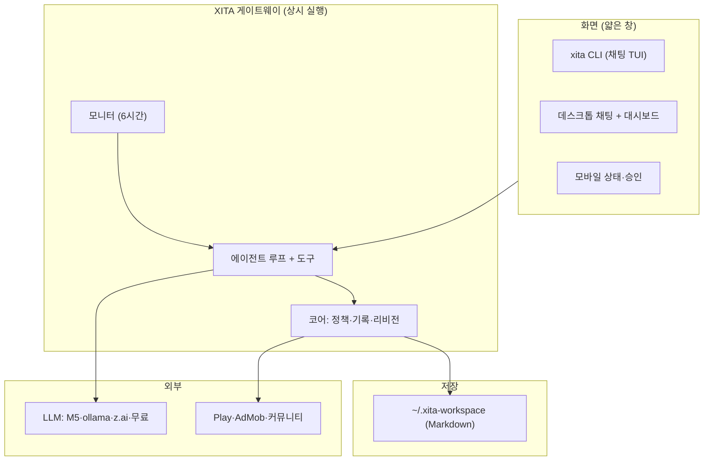
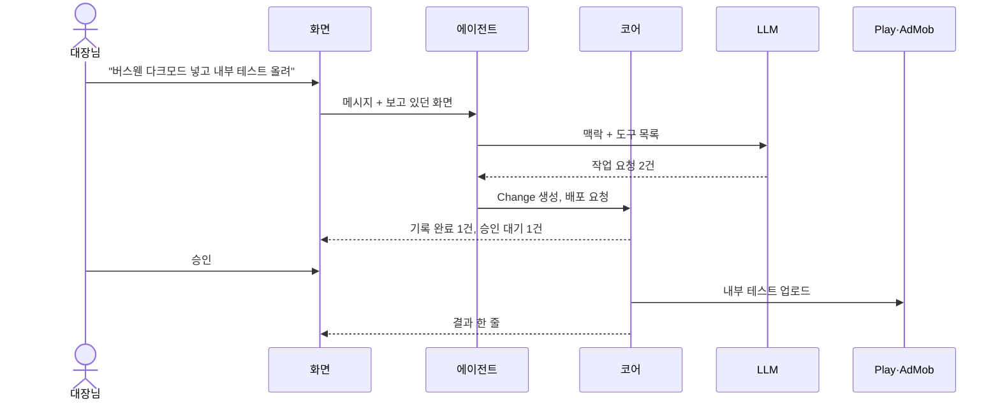
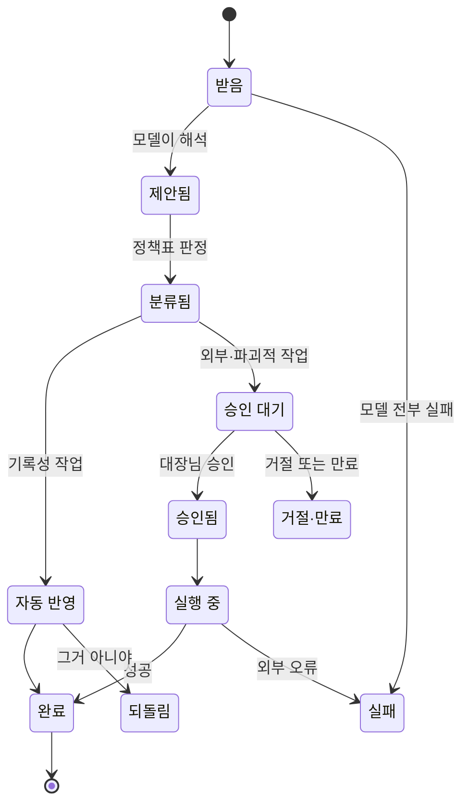
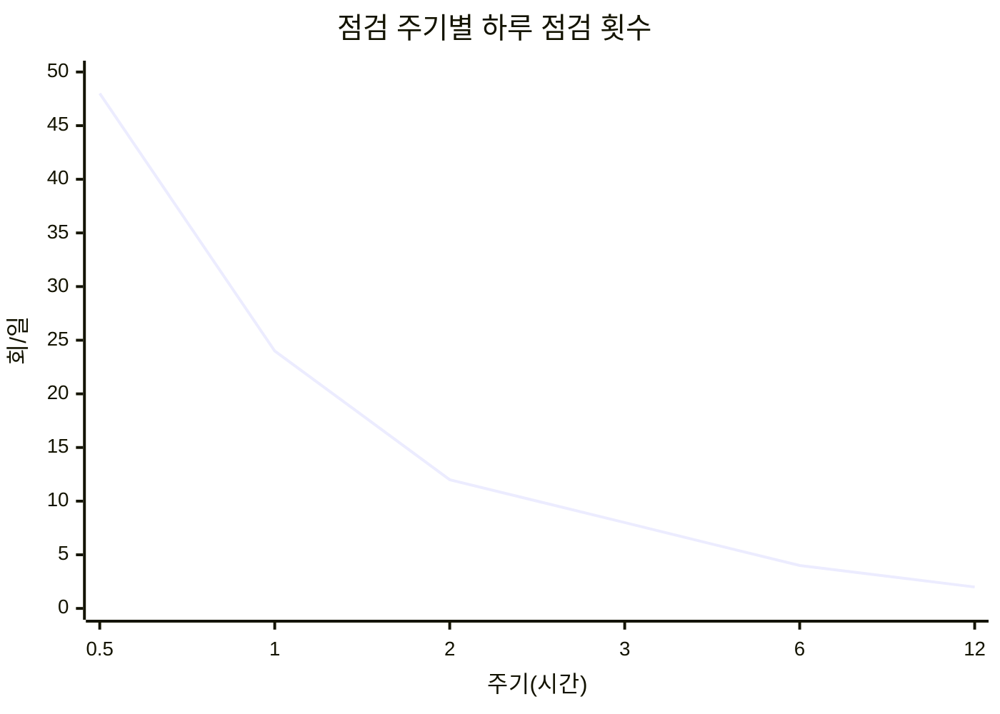
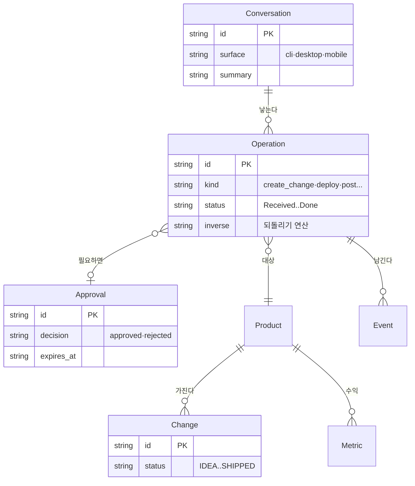
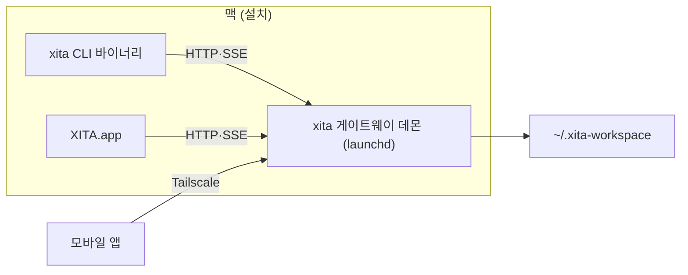
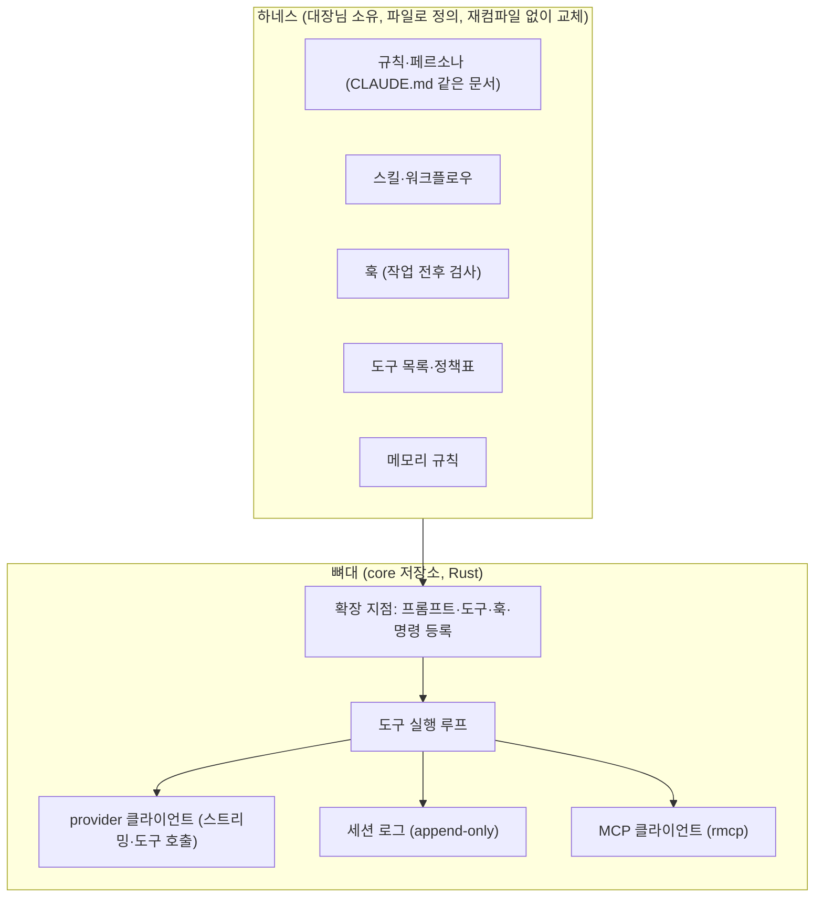

# XITA 에이전트 OS 도메인 지도

> 대상 사용자: 앱 여러 개를 혼자 운영하는 개발자(대장님 1인) · 수익 모델: 없음, 개인 도구 `[가정]` (관리 대상 앱의 AdMob 수익을 극대화하는 것이 목적) · 플랫폼: CLI, macOS 데스크톱, 모바일, 웹 콘솔 · 작성일: 2026-10-21
> `[가정]` 확인 안 된 전제 · `[추정]` 출처 없는 값 · `[확인 필요]` 출시 전 반드시 검증 · `모름` 도메인 공백
> `[코드: 경로]` 코드에서 확인 · `[미구현]` 기획엔 있고 코드엔 없음

**워크플로우:** [workflow.html](./workflow.html)을 브라우저에서 열면 "말로 기록", "말로 배포", "먼저 조언"과 예외 4개 시나리오가 재생된다.

**방향 한 줄:** 사람은 상태만 보고 말로 시킨다. 에이전트는 말을 **작업 요청(Operation)**으로 바꾸고, 코어는 정책에 따라 자동 반영할지 승인을 받을지 정한다. 모든 화면(CLI·데스크톱·모바일)은 같은 코어에 붙는 얇은 창이다.

## 한눈 지도



## 렌즈 표

| 렌즈 | 내용 | 신뢰 | 출처 |
| --- | --- | --- | --- |
| 1. 주체 | 대장님(유일한 사람), 에이전트, 코어, 외부 실행 대상(Play·AdMob·커뮤니티), LLM 제공사, 코딩 에이전트(opencode·codex·claude code·xal) | 높음 | [코드: rust/xita-core/src/agent.rs], [코드: apps/server/app/v4/ai_router.ts] |
| 2. 핵심 루프 | 말한다 → 기록·실행된다 → 대시보드로 확인 → 조언을 받는다 → 다시 말한다 | 높음 | 신규 방향 |
| 3. 상태 수명주기 | Operation(신규) + Change 기존 상태(IDEA→PLAN→BUILD→REVIEW→SHIP_READY→SHIPPED) | 높음 | [코드: apps/server/app/v4/domain.ts] |
| 4. 숫자 규칙 | 모니터 주기, 모델 실패 대기, 승인 만료, 자동 반영 기준 | 중간 | [코드: apps/server/app/portfolio/monitor.ts] |
| 5. 돈 흐름 | 들어옴: AdMob(구현), Play 인앱(미구현). 나감: LLM 구독·토큰, M5 전기, 스토어 수수료 | 중간 | [코드: apps/server/app/portfolio/revenue.ts] |
| 6. 예외·어뷰징 | 잘못 알아들음, 프롬프트 주입(홍보 댓글·웹 내용), 모델 전부 실패, 외부 실행 실패, 동시 수정 | 낮음 | 아래 표 |
| 7. 운영·CS | 1인. 사람이 할 일은 승인과 확인만. 키 갱신, 쿼터 소진 대응이 남음 | 중간 | 아래 표 |
| 8. 규제 | 스토어 정책, AdMob 무효 트래픽, 커뮤니티 홍보 규칙, LLM 제공사 데이터 정책 | 낮음 | [확인 필요] |
| 9. 고유 렌즈 | ① 에이전트 런타임(harness)과 모델 라우팅 ② 화면 배포·설치 형태 | 중간 | 조사 결과 |

## 1. 주체



- **사람은 대장님 한 명.** 권한·멀티 테넌트는 필요 없다. 대신 "기기"가 주체 역할을 한다(맥, 폰, M5) [코드: apps/server/app/v4/devices.ts].
- **코딩 에이전트는 별도 주체로 유지.** XITA 에이전트가 코드를 직접 고치지 않고, opencode·codex·claude code·xal에 일을 넘긴다(dispatch) [코드: rust/xita-core/src/agent.rs].

## 2. 핵심 루프


- 첫 바퀴: 설치 직후 "내 프로젝트 보여줘" 한 마디로 현황이 나와야 한다. 기존 workspace import가 이미 있어 첫 바퀴 시간이 짧다 [코드: apps/server/app/portfolio/planner_import.ts].
- 다시 오는 이유: 6시간 점검 조언과 수익 변화 알림 [코드: apps/server/app/portfolio/monitor.ts].

## 3. 상태 수명주기

신규 핵심 객체 **Operation(작업 요청)** `[미구현]`. 에이전트가 하는 모든 변경은 이걸 거친다. 그래야 되돌리기·감사·승인이 한 곳에 모인다.



기존 Change 수명주기는 그대로 쓴다 [코드: apps/server/app/v4/domain.ts]. IDEA·PLAN·BUILD·REVIEW·SHIP_READY·SHIPPED·PAUSED·CANCELLED. SHIPPED로 가려면 REVIEW/SHIP_READY에서 승인이 필요하다 [코드: apps/server/app/v4/ops.ts]. Proposal(approved/rejected/modified)이 이미 승인 객체 역할을 한다 [코드: apps/server/app/v4/ops.ts] → Approval로 승격 후보.

## 4. 숫자 규칙

| 규칙 | 공식 후보 | 파라미터 | 기준값 | 설정값화 |
| --- | --- | --- | --- | --- |
| 모니터 주기 | A: 고정 N시간 / B: 신호 있을 때만 알림(침묵 규약) | `XITA_MONITOR_HOURS` | 현재 6시간 [코드: apps/server/app/portfolio/monitor.ts], OpenClaw heartbeat 기본 30분 ([docs.openclaw.ai/gateway/heartbeat](https://docs.openclaw.ai/gateway/heartbeat)) | 예 (이미) |
| 모델 실패 대기 | A: 고정 cooldown / B: 지수 백오프 | cooldown | 현재 10분 [코드: apps/server/app/v4/ai_router.ts] | 예 |
| 자동 반영 범위 | A: 종류별 정책표 / B: 모델 확신도 임계값 / C: A+B | 작업 종류, 확신도 | 추천 A. 확신도는 모델마다 보정이 안 돼 기준으로 쓰기 어렵다 `[추정]` | 예 |
| 승인 만료 | A: 만료 없음 / B: N시간 후 만료 | 만료 시간 | 24시간 `[가정]` | 예 |
| 대화 → 기록 정리 시점 | A: 매 턴 / B: 대화 종료·N분 무응답 / C: 명시적 "정리해" | 대기 시간 | 추천 B+C `[가정]` | 예 |

주기별 하루 점검 횟수 = 24 / 주기(시간). AI 조언 호출은 신호가 바뀔 때만이라 이 값이 상한이다 [코드: apps/server/app/portfolio/monitor.ts].



## 5. 돈 흐름

값은 상대 비율이 아니라 **구조만** 보이기 위한 동일 가중치다. 실제 금액은 30일 AdMob $0.33 [코드: workspace revenue 조회 결과, 2026-10-18 세션], 구독료는 `모름`.

```mermaid
sankey-beta
AdMob,"대장님 수익",10
"Play 인앱 (미구현)","대장님 수익",10
"대장님 수익","LLM 구독 (z.ai·Alibaba)",6
"대장님 수익","M5 전기·장비",4
"대장님 수익","스토어 등록비·수수료",4
"대장님 수익",순이익,6
```

- **XITA 자체는 돈을 벌지 않는다** `[가정]`. 그래서 핵심 숫자는 "AI 비용 ≤ 늘어난 수익"이다. 무료·로컬 모델 우선 라우팅이 이미 구현돼 있다 [코드: apps/server/app/v4/ai_router.ts].
- 나중에 제품화한다면 결정 목록 #7.

## 데이터 모델



| 엔티티 | 저장 위치 | 만드는 단계 | 바꾸는 단계 | 민감 필드 |
| --- | --- | --- | --- | --- |
| Conversation `[미구현]` | workspace/conversations | say | record | 대화 원문(수익·키가 섞일 수 있음) |
| Operation `[미구현]` | workspace/operations | propose, monitor | apply, exec, undo | 없음 |
| Product | workspace/products [코드: apps/server/app/v4/domain.ts] | 기획 확정 | apply | 없음 |
| Change | workspace/changes [코드: apps/server/app/v4/domain.ts] | apply | apply, undo | 없음 |
| Approval (현 Proposal) | workspace/proposals [코드: apps/server/app/v4/ops.ts] | ask | approve, reject | 없음 |
| Event | workspace events [코드: apps/server/app/v4/event_bus.ts] | 모든 변경 | 없음(추가만) | 없음 |
| Metric | workspace/revenue + AdMob [코드: apps/server/app/portfolio/revenue.ts] | monitor | monitor | 수익 (로컬 모델만) |

## 6~8. 예외·운영·규제

| 렌즈 | 항목 | 대응 | 출처 |
| --- | --- | --- | --- |
| 예외 | 잘못 알아들어 엉뚱한 프로젝트에 기록 | Operation 단위 되돌리기 + 한 줄 보고에 대상 명시 | 신규 설계 |
| 예외 | 프롬프트 주입: 홍보 댓글·웹 페이지·커밋 메시지 속 지시 | 외부 텍스트는 데이터로만 다루고, 외부 작업은 항상 승인 | [확인 필요] |
| 예외 | 모델 전부 실패 (M5 꺼짐, 쿼터 소진) | 체인 대체 → 규칙 모드 안내 [코드: apps/server/app/v4/ai_router.ts] | 2026-10-18 실측: Alibaba 쿼터 소진 시 xal 300초 대기 |
| 예외 | 여러 화면에서 동시 수정 | 리비전·ws_rev 충돌 판정 [코드: apps/server/app/v4/revision.ts], [코드: rust/xita-core/src/operation.rs] | 코드 |
| 예외 | 작은 로컬 모델의 tool calling 불안정 | 기록·분류는 로컬, 복잡한 계획은 z.ai, 실패 시 확인 질문 | [확인 필요] PoC |
| 운영 | 키·로그인 만료 (opencode CLI 키 만료 확인됨) | 상태 화면에 연결 상태 표시 [코드: apps/server/public/app/ai.js] | 2026-10-18 실측 |
| 운영 | 상시 실행: 세션 끝나면 서버도 꺼짐 | launchd 데몬으로 설치 `[미구현]` | 2026-10-21 확인(3333 응답 없음) |
| 운영 | 모바일 원격 접속 | Tailscale 내부망 + 기기 토큰 [코드: apps/server/app/v4/devices.ts] | [확인 필요] |
| 규제 | 스토어 업로드·심사 정책 | 업로드는 항상 승인 | [확인 필요] Play Console 정책 |
| 규제 | AdMob 무효 트래픽(본인 클릭·테스트 광고) | 테스트 광고 신호 감지 [코드: apps/server/app/portfolio/monitor.ts] | [확인 필요] AdMob 정책 |
| 규제 | 커뮤니티별 홍보 규칙 | 자동 게시 금지, 규칙은 대장님이 입력 [코드: apps/server/app/portfolio/promo.ts] | [확인 필요] 각 커뮤니티 |
| 규제 | 외부 LLM으로 보내는 데이터 | 민감 작업은 로컬 provider만 [코드: apps/server/app/v4/ai_router.ts] | [확인 필요] z.ai·opencode 무료 모델 데이터 정책 |

## 9. 고유 렌즈

### 9-1. 에이전트 런타임 (뼈대)

XITA 에이전트는 **코딩 에이전트가 아니라 도메인 에이전트**다. 필요한 도구는 bash·파일 편집이 아니라 `xita_work_add`, `xita_deploy`, `xita_revenue` 같은 XITA API다. 이미 MCP 도구가 일부 있다 [코드: apps/cli/xita-mcp.mjs].

| 후보 | 언어·라이선스 | Chat Completions 호환 (LiteLLM·GLM) | 붙이는 방식 | 판단 |
| --- | --- | --- | --- | --- |
| **pi** (earendil-works/pi, 구 badlogic/pi-mono) | TS · MIT | ○ `openai-completions` + baseUrl | 라이브러리로 내장 (`createAgentSession`, customTools, JSONL 세션), pi-tui | TS로 갈 때의 1순위였음. core를 Rust로 정해 설계 참고만 (provider `compat`·세션 JSONL 구조) |
| **opencode** (anomalyco/opencode) | TS · MIT | ○ z.ai·Ollama 공식, 무료 Zen 모델 | 별도 서버 `opencode serve` + SDK | 설계 참고. 완성도 최고지만 코딩용 기본값을 걷어내야 하고, XITA 옆에 **서버가 하나 더** 생긴다. 릴리스가 매우 잦다 |
| Vercel AI SDK | TS · Apache-2.0 `[추정]` | ○ `@ai-sdk/zai`, openai-compatible | 루프 직접 조립 | 대안. 세션·압축·TUI를 다 만들어야 한다 |
| Codex CLI (codex-rs) | Rust · Apache-2.0 | ✕ `wire_api="chat"` 제거됨, Responses 전용 | app-server (experimental), crates.io 미배포 | 탈락. z.ai·Alibaba·Zen chat 엔드포인트 못 씀 |
| Claude Agent SDK | Anthropic 상용 약관 | ✕ | SDK | 탈락. Claude 전용 |
| DeepSeek Harness ("dsv harness" 추정) | TS(Node ≥22.19) · MIT | ○ (내부적으로 pi-ai 사용) | web·headless(NDJSON)·SDK(stdio JSON-RPC)·ACP, Electron. **TUI 없음** | 설계 참고만. 패키지 약 300개를 Cordis 플러그인으로 조립, 0.2.1-rc.2, 30일 커밋 약 3,261개, SAFETY.md에 "production-ready 아님". 상주 메모리 수백 MB `[추정]` |
| **rig-core** (Rust) | Rust · MIT | ○ OpenAI 호환 base_url `[추정: 세부 API 미확인]` | 라이브러리 (axum 데몬에 내장), MCP는 `rmcp` | **Rust로 갈 때 1순위.** 0.45.0 (2026-10-19) |
| async-openai (Rust) | Rust · MIT | ○ `with_api_base` | 라이브러리, 루프는 직접 (약 300줄 `[추정]`) | rig 대안 |
| Goose 크레이트 (Rust) | Rust · Apache-2.0 | ○ openai_compatible | `goose-sdk` 0.1.0-alpha.12 | alpha. 정식판 나오면 재검토 |
| Goose | Rust · Apache-2.0 | ○ | ACP, REST | 대안. 커스텀 배포판 가능하지만 Rust |
| Crush | Go · FSL-1.1 | ○ `[추정]` | CLI | 탈락. 라이선스 |

출처: [github.com/earendil-works/pi](https://github.com/earendil-works/pi), [opencode.ai/docs/server](https://opencode.ai/docs/server/), [opencode.ai/docs/providers](https://opencode.ai/docs/providers/), [learn.chatgpt.com/docs/config-file/config-reference](https://learn.chatgpt.com/docs/config-file/config-reference), [code.claude.com/docs/en/agent-sdk/overview](https://code.claude.com/docs/en/agent-sdk/overview), [github.com/deepseek-ai/deepseek-harness](https://github.com/deepseek-ai/deepseek-harness), [github.com/charmbracelet/crush LICENSE](https://github.com/charmbracelet/crush/blob/main/LICENSE.md). 스타·릴리스 날짜는 2026-10-21 `gh api` 조회.

- "opencodex"는 같은 이름의 활성 프로젝트가 없다. opencode를 말씀하신 것으로 보고 정리했다 `[추정]`.
- "dsv harness"도 정확히 일치하는 게 없다. DeepSeek Harness(`dsh`)로 추정 `[추정]`.

**xal은 무엇으로 만들었나** (바이너리 분석 + 저장소 확인, 2026-10-21)
- **TS 루프·화면 + Rust 네이티브 애드온 하이브리드.** 저장소 `github.com/xal-sh/xal`: `packageManager: bun@1.3.14`, `@opentui/core ^0.5.1`, Rust 크레이트 `xal-native`, 빌드는 `scripts/native/build.ts`에서 `bun build --compile` (실행 파일 안에는 Bun v1.4.0 런타임 문자열). arm64 94MB, 0.1.0-beta.256.
- 화면은 **OpenTUI**: Zig 네이티브 코어 + TS 바인딩, 0.6.6, MIT. Bun ≥1.3.14 또는 Node ≥26.4(`--experimental-ffi`) 필요. opencode가 실서비스에 쓴다. 출처: [github.com/anomalyco/opentui](https://github.com/anomalyco/opentui).
- opencode 포크는 아니다. AI SDK(`@ai-sdk/*`) 흔적이 없고 자체 플러그인 구조(`registerTool`·`registerProvider`·`registerCommand`·`registerHook`·`registerPrompt`), MCP 클라이언트, skills, subagent, compaction, goal 루프를 가진 독자 harness다.
- **xal 방식으로 만들려면:** Bun + TypeScript로 루프·화면을 짜고 `@opentui/core`(또는 `@opentui/react`·`@opentui/solid`)로 그린 뒤 `bun build --compile`로 묶는다. 무거운 부분만 Rust 애드온으로 뺀다. 크로스 빌드 전 `bun install --os="*" --cpu="*" @opentui/core@<ver>`, Linux는 `OPENTUI_LIBC` 지정 필요.
- **Rust 코어와 섞으면:** 루프는 Rust 데몬, OpenTUI는 화면 전용 클라이언트(HTTP·SSE)로 둘 수 있다. 대가는 Bun 런타임이 실행 파일에 들어가 60~100MB `[추정]`. 순수 Rust로 가면 **ratatui**(Codex TUI가 사용, 0.30.2, 실행 파일 수 MB `[추정]`).

### 9-2. 설치 형태와 화면 배치



- **레퍼런스가 한 방향을 가리킨다.** opencode(서버 하나에 TUI·데스크톱·SDK가 붙음), Codex(app-server를 IDE·데스크톱이 공유), OpenClaw(게이트웨이 하나에 CLI·웹·macOS·모바일·메신저), Claude Code(모바일은 로컬 세션에 붙는 창). 출처: [opencode packages](https://github.com/anomalyco/opencode/tree/dev/packages), [developers.openai.com/codex/app-server](https://developers.openai.com/codex/app-server), [docs.openclaw.ai](https://docs.openclaw.ai/), [code.claude.com/docs/en/mobile](https://code.claude.com/docs/en/mobile).
- **현재 XITA는 코어가 둘이다.** TS 서버 [코드: apps/server/app/v4/] 와 Rust 코어 [코드: rust/xita-core/src/] 가 같은 workspace를 각각 쓴다. 데스크톱은 Rust 라이브러리를 절대경로로 링크한다 [코드: macos/XitaApp/Package.swift]. 실제로 이벤트 필드명이 `eventType`과 `event_type`으로 갈라진 흔적이 있다 [코드: apps/server/app/v4/ops.ts]. 15종 타입 parity를 손으로 맞춰야 한다 [코드: rust/xita-core/src/storage.rs].

**현재 자원 사용 실측** (2026-10-21, 샌드박스 서버, 개발 모드 `node ace serve`): 상주 메모리 2개 프로세스 합계 **403MB**, 기동 후 첫 응답까지 30초 이상(ts-node 컴파일 포함), 제품 목록 API 응답 약 4ms. 체감 지연의 대부분은 모델 응답(2026-10-18 실측 0.4초~20초)이다. Rust 전환의 실익은 **상주 메모리·유휴 CPU·기동 시간·단일 실행 파일 배포**이고, API 지연은 이미 충분히 짧다. 프로덕션 빌드 Node의 메모리는 측정하지 않았다.

### 9-3. 뼈대와 하네스의 경계

xita CLI는 대장님의 하네스와 작업 철학을 담는 그릇이다. 코드에는 **바뀌지 않는 기초만** 넣고, 판단과 성격은 실행 시 읽는 하네스 층에 둔다.



- 확장 지점은 xal의 `registerTool`·`registerProvider`·`registerCommand`·`registerHook`·`registerPrompt`와 같은 범위로 잡는다. 이 이상은 뼈대에 넣지 않는다.
- 하네스 정의 형식(Markdown·YAML·스크립트 훅)과 위치는 결정 #9.

### 9-4. CLI 개발 철학: DeepSeek Harness를 따른다 (2026-10-21 대장님 결정)

출처: [github.com/deepseek-ai/deepseek-harness](https://github.com/deepseek-ai/deepseek-harness)의 `AGENTS.md`, `docs/architecture.md`, `.agents/notes/implemented/architecture/*` (master, 2026-10-17). 문서 기준이고 소스는 직접 읽지 않았다. **저장소에 terminal-bench·SWE-bench 점수는 없다.** "성능이 가장 좋다"는 저장소로는 확인되지 않으며, 따라 할 근거는 아래 설계 원칙이다.

| dsh 원칙 | 뜻 | xita 적용 | 위치 |
| --- | --- | --- | --- |
| Model-visible ⟺ logged | 모델에 간 요청은 로그만으로 바이트 단위 재구성 가능 | append-only 세션 이벤트 + 순수 함수 projection으로 메시지 생성 | 뼈대 |
| 캐시 안정성은 결과로 생긴다 | 위 원칙을 지키면 prefix cache가 자동 유지 | 헤더(설정·도구 스키마)는 바뀔 때만 기록, 프롬프트 변경은 history 뒤에 append. 두 번째 요청부터 cache-read > 0 테스트 | 뼈대 |
| Plugins, not loop changes | 새 동작은 확장 지점에만 | turn/step 이벤트 + 훅 체인(pre-step, request, request-error, tool pre/execute/post) | 뼈대 |
| 병렬 도구 + exclusive barrier | 안전한 호출은 최대 10개 동시, 판단 불가면 exclusive | `trait Tool { concurrency() }` + tokio semaphore | 뼈대 |
| 실패해도 짝을 맞춘다 | 취소·실패 시 도구 결과를 합성 (`TOOL_OUTCOME_UNKNOWN` 등), 결과 불확실한 작업은 자동 재시도 금지 | 루프 복구 모듈 | 뼈대 |
| 세션 버전 = 정수 하나 | `session.vN.jsonl`, 인접 migration, 미래 버전 거부, 이벤트 추가는 `ignorable` | 세션 저장 모듈 | 뼈대 |
| No hardcoded tunables · fails loud · explicit | 바뀌는 값은 검증되는 설정, 잘못된 설정은 바로 에러 | 설정 로더 | 뼈대 |
| profile = bundle 층 + patch | 구성을 층으로 쌓고 row id로 교체·삽입, `--dump-config` | 하네스 정의(결정 #9)를 이 방식으로 | 뼈대(로더) / 하네스(내용) |
| 재시도·compaction·spill·sandbox·승인 | 전부 선택형 seam | 재시도(transient 5종, 2회), compaction(80% 또는 W−출력−64k, 16% 보존), 12.5k 토큰 넘는 결과 spill | 하네스 |
| 최소 도구 구성 | 벤치용 `sdk-minimal`: 페르소나 한 줄 + 도구 3개 | xita 기본 프로필도 최소 도구로 시작 | 하네스 |
| PTC (`run_code`) | 도구 호출 대신 코드로 여러 도구를 묶어 실행 | 후순위 | 하네스 |
| 문서마다 "Model Experience" | 모든 모듈이 토큰·KV 캐시 영향을 적는다 | crate README 규칙 | 프로세스 |

- **따라 하지 않을 것:** dsh는 세션 로그를 DeepSeek로 업로드하는 기능이 기본으로 켜져 있다(`2026-09-14-session-log-upload-default.md`). xita는 로그를 밖으로 보내지 않는다.
- **차이:** dsh는 TypeScript/Node + Cordis이고 "특권 core 없음"이다. xita는 Rust로 같은 경계를 crate와 trait으로 만든다. 플러그인은 동적 로딩 대신 하네스 파일(프로필·훅 실행 파일)로 갈아 끼운다.

## 저장소 구조

대장님 제안: Xita 조직 + `cli`·`desktop`·`mobile` 저장소 분리, core 여부. **core를 Rust로 확정한 기준**으로 정리.

| 안 | 구성 | 장점 | 단점 |
| --- | --- | --- | --- |
| A. 4개 분리 | core, cli, desktop, mobile | 대장님 원안 | cli는 core 크레이트(프로토콜·도메인 타입)를 그대로 쓰므로 나누면 버전 맞추기만 늘어난다 |
| **B. 3개 (추천)** | `xita`: Cargo workspace(`crates/core`·`protocol`·`gateway`(xitad)·`cli`(ratatui)) + 웹 콘솔 정적 파일 / `desktop`: SwiftUI / `mobile`: Expo | 언어·릴리스 주기가 다른 것만 나눈다. desktop·mobile은 `protocol`이 내보내는 스키마(OpenAPI·JSON Schema)로 생성한 클라이언트만 쓴다 | 프로토콜 버전 관리와 계약 테스트 필요 |
| C. 1개 모노레포 | 위 전부 한 저장소 | 한 커밋으로 원자적 변경 | Cargo·SwiftPM·Expo 혼합 CI |

**core는 둔다. 단 하나, Rust로.** CLI는 core와 같은 저장소에 둔다. desktop·mobile은 core를 링크하지 않고 게이트웨이 프로토콜(HTTP·SSE)로만 붙는다. 지금처럼 데스크톱이 Rust 라이브러리를 절대경로로 링크하는 방식은 걷어낸다 [코드: macos/XitaApp/Package.swift].

## 레퍼런스 대조

O 있음 · △ 부분 · 빈칸 없음/확인 못 함. 출처는 위 9장과 [linear.app/docs/pulse](https://linear.app/docs/pulse), [linear.app/developers/agents](https://linear.app/developers/agents), [plane.so 자체 호스팅 AI](https://plane.so/blog/plane-ai-is-coming-to-self-hosted-deployments).

| 항목 | XITA 기획 | OpenClaw | Linear | Plane | opencode |
| --- | --- | --- | --- | --- | --- |
| 자연어로 작업 생성·수정 | O (신규) | △ | O | O | |
| 대화 → 기록 자동 정리 | O (신규) | △ 세션·메모리 | O | △ | △ 세션 요약 |
| 상태 대시보드 | O [코드: apps/server/public/app/views.js] | △ | O Pulse | O | |
| 여러 화면이 한 서버 공유 | O (신규) | O | O | △ | O |
| 위험 작업 승인 게이트 | O (Operation 정책) | △ 도구 정책 | △ | | O 권한 요청 |
| 주기 점검·먼저 알림 | O [코드: apps/server/app/portfolio/monitor.ts] | O heartbeat | O Pulse | | |
| 침묵 규약 (알릴 게 없으면 조용) | `[미구현]` 누락 후보 | O `NO_REPLY` | | | |
| 메모리 (선호·맥락 장기 기억) | `[미구현]` 누락 후보 | O | | | △ |
| 메신저 연동 (텔레그램 등) | `[미구현]` 누락 후보 | O | O Slack | | |
| 수익·지표 연동 | O AdMob [코드: apps/server/app/portfolio/revenue.ts] | △ 확장 | | | |
| 로컬 LLM | O | O | | O | O |
| 되돌리기 | `[미구현]` 신규 설계 | | | | O revert |

누락 후보: 침묵 규약, 장기 메모리, 메신저 연동 → 결정 목록 #6에 반영. 승인 게이트를 1급 기능으로 둔 제품이 없고 AdMob 연동 사례도 못 찾았다. 이 둘이 차별점이다.

## 결정 목록

되돌리기 비용이 높은 것부터.

| # | 결정할 것 | 선택지 | 추천 기본값과 근거 | 되돌리기 비용 |
| --- | --- | --- | --- | --- |
| 1 | 코어를 무엇으로 하나 | A: TS 하나 / B: Rust 하나 (게이트웨이도 Rust) / C: 지금처럼 둘 | **확정: B** (2026-10-21 대장님: 저지연·고속·저부하). 기존 `rust/xita-core`(3,766줄, 외부 의존성 0)를 기반으로 한다. TS 서버의 포트폴리오·AI 라우터·모니터·기획·홍보는 Rust로 옮겨야 한다 | 높음 |
| 2 | 에이전트 런타임 | A: 프레임워크 없이 최소 뼈대 직접 / B: rig-core 위 루프 / C: Goose 크레이트(alpha) | **확정: A** (2026-10-21 대장님: "기초 뼈대만, 그 위에 나의 하네스"). 뼈대 = provider 클라이언트(async-openai 또는 reqwest 직접, Chat Completions 스트리밍·도구 호출 파싱) + 도구 실행 루프 + 세션 로그 + `rmcp`. 프롬프트·정책·도구·스킬·훅·메모리는 전부 하네스 층에 둔다. PoC 통과 기준: M5(qwen 27B)·z.ai GLM에서 도구 호출 성공 | 높음 |
| 3 | 저장소 구조 | A 4개 / B 3개 / C 1개 | **확정: B 3개** (2026-10-21). 조직 `xita-app`(2026-10-21 비어 있음 확인, 생성은 대장님 확인 후) + 저장소 `core`(Rust: core·protocol·xitad·xita CLI) · `desktop`(SwiftUI) · `mobile`(Kotlin Compose) | 중간 |
| 3-1 | CLI 화면 기술 | A: ratatui (순수 Rust) / B: OpenTUI (Bun, xal 방식) | **확정: A.** core 크레이트를 직접 쓰고, 데몬과는 Unix 소켓. 런타임 없는 단일 실행 파일 | 중간 |
| 4 | 데스크톱 기술 | A: SwiftUI/AppKit (현행) / B: Tauri 2 (Rust + WebView) / C: GPUI·egui·iced (순수 Rust GUI) | **확정: A.** 맥에서는 시스템 프레임워크를 쓰는 네이티브가 가장 가볍다: 현 XITA.app 번들 3.6MB, 실행 시 RSS 150MB(공유 프레임워크 포함) 실측. B는 WebView 프로세스가 추가되고, C는 채팅·마크다운·한글 입력·접근성 성숙도가 낮다 `[추정]`. 메뉴바·알림·키체인·`SMAppService`로 데몬 등록까지 네이티브로 처리. 윈도·리눅스가 필요해지면 B | 중간 |
| 4-1 | 모바일 기술 | A: Expo (현행) / B: Kotlin Compose 네이티브 (안드로이드) | **확정: B.** 역할이 상태·승인·채팅뿐인 얇은 창이라 네이티브가 가장 가볍고 빠르다. 대장님 기기가 갤럭시라 안드로이드 우선. 전환 전까지 Expo 유지 | 낮음 |
| 9 | 하네스 정의 형식 | A: Markdown 규칙 + YAML 정책 + 실행 파일 훅 (Claude Code 방식) / B: WASM 플러그인 / C: Lua 등 내장 스크립트 | **A로 시작** `[가정]`. 대장님이 이미 쓰는 CLAUDE.md·skills 구조를 그대로 옮길 수 있다 | 중간 |
| 5 | 자동 반영 범위 (정책표) | A: 기록성 전부 자동 / B: 전부 확인 / C: 종류별 표 | **C.** 아이디어·메모·상태 이동은 자동 + 되돌리기, 배포·게시·삭제·외부 전송은 승인 | 낮음 |
| 6 | 누락 후보 채택 | 침묵 규약 / 장기 메모리 / 텔레그램 연동 | 침묵 규약은 바로 채택(조언 피로 방지). 메모리는 대화 요약으로 시작. 메신저는 모바일 앱 이후 | 낮음 |
| 7 | XITA를 제품으로 팔 것인가 | A: 개인 도구 / B: 오픈소스 / C: 유료 | **A로 시작** `[가정]`. 팔 생각이 있으면 #3을 C로, 라이선스를 먼저 정한다 | 중간 |
| 8 | 배포 형태 | A: Homebrew tap + launchd 데몬 / B: 직접 설치 스크립트 | **A.** `xita`(CLI)·`xitad`(게이트웨이) Rust 실행 파일. Node 24 의존이 사라진다 | 낮음 |

## 코드 기준

| 기준 commit | 날짜 | 읽은 소스 |
| --- | --- | --- |
| 77b38e1 (+ 미커밋 변경 62개) | 2026-10-21 | apps/server/app/v4/, apps/server/app/portfolio/, apps/server/start/routes.ts, apps/cli/, rust/xita-core/src/, macos/XitaApp/Package.swift, apps/mobile/src/api/ |

## 다음 단계

- 결정 #1~#3이 정해지면 `veteran` planning으로 넘긴다. 1단계 후보: 현 TS 서버 상시 실행(launchd, 전환기 유지) → Rust `xitad` 골격 + rig PoC(도구 호출) → Operation·정책표 → ratatui `xita` 채팅 CLI → 기능을 TS에서 Rust로 순차 이전 → 데스크톱 채팅.
- 드릴다운 후보: Operation 정책표, 대화 → 기록 정리 규칙, 게이트웨이 프로토콜(OpenAPI).

## 변경 이력

| 날짜 | 요청 | 바뀐 곳 |
| --- | --- | --- |
| 2026-10-21 | 최초 생성 (자연어 명령 중심 재편, harness 조사, 저장소 분리 판단) | 전체 |
| 2026-10-21 | CLI는 DeepSeek Harness 개발 철학을 따름 | 9-4 절 |
| 2026-10-21 | 조직 `xita-app` 확정, 에이전트는 최소 뼈대 + 하네스 분리로 확정 | 결정 #2·#3·#3-1·#4·#4-1·#9, 9-3 절 |
| 2026-10-21 | 저장소 3개·조직명 후보, 화면별 기술(CLI ratatui, 데스크톱 SwiftUI, 모바일 Compose) | 결정 #3·#3-1·#4·#4-1 |
| 2026-10-21 | core를 Rust로 확정, DeepSeek Harness·OpenTUI·Rust 루프 조사 반영, 저장소 3개 안 | 9-1 표·xal 절, 자원 실측, 저장소 구조, 결정 #1·#2·#3·#3-1·#8 |
