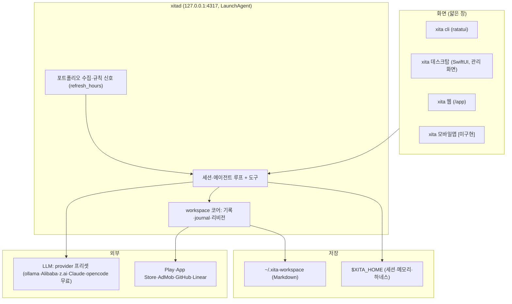
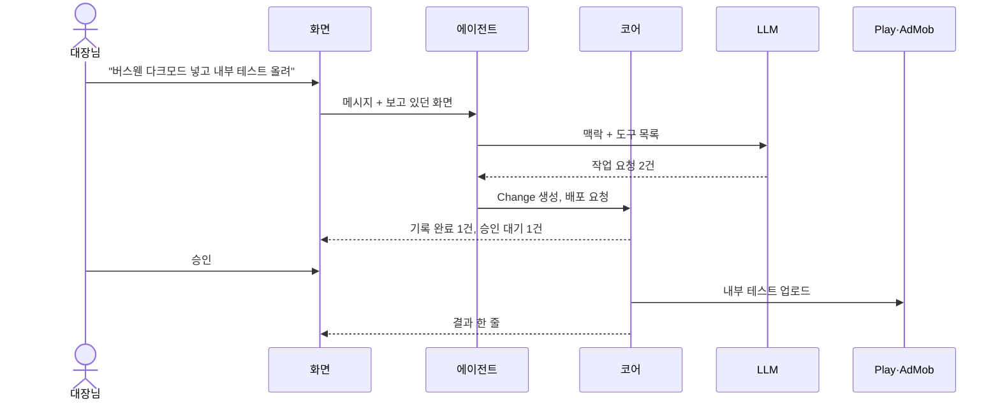
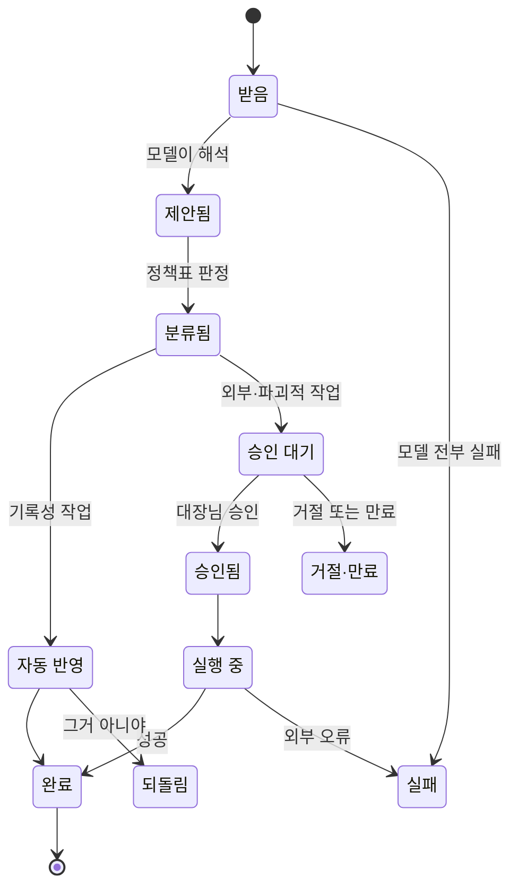
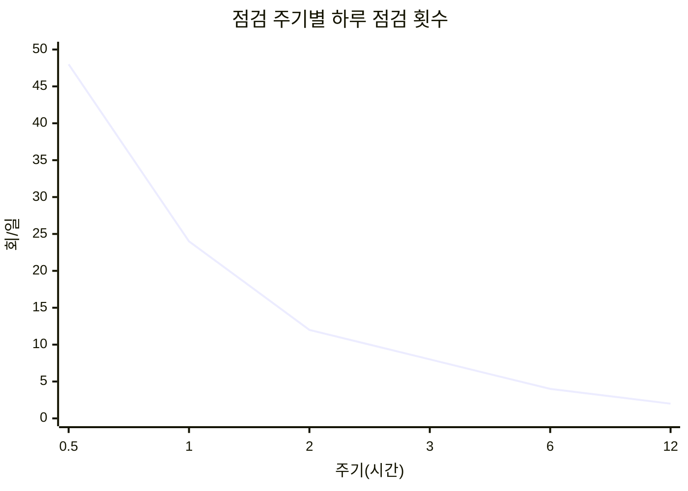
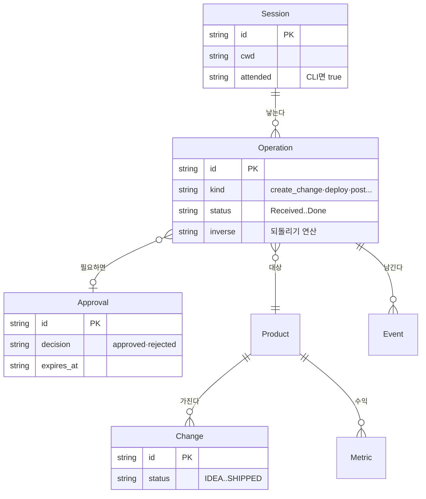
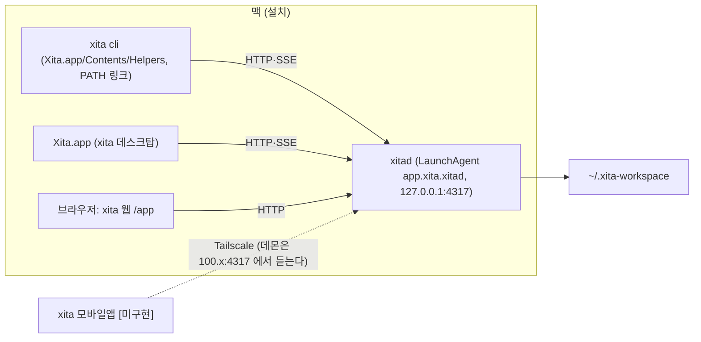
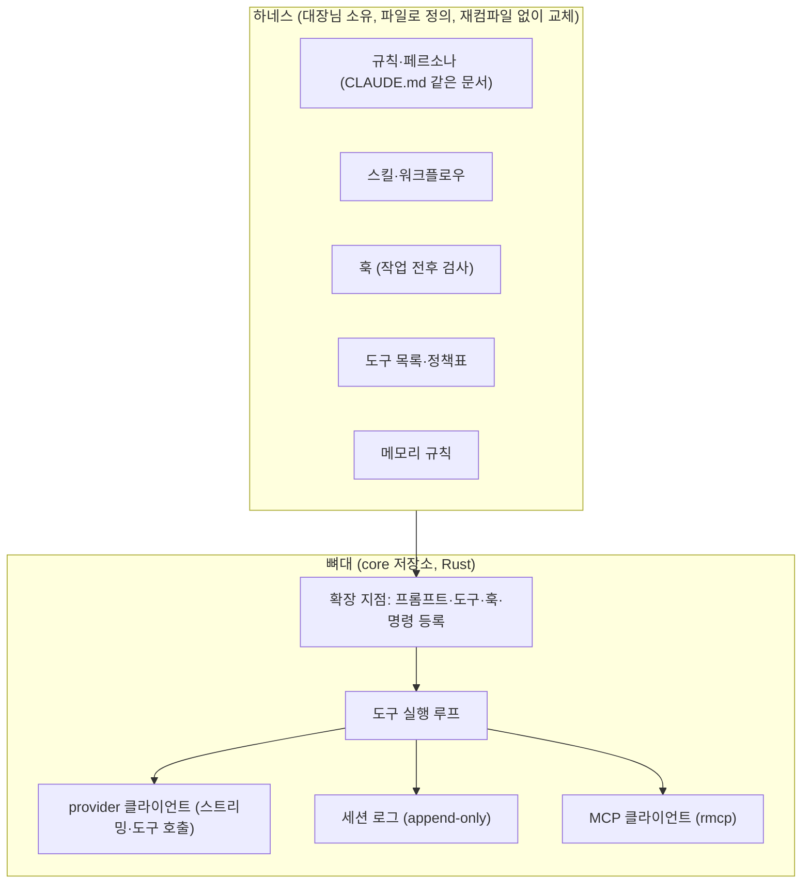
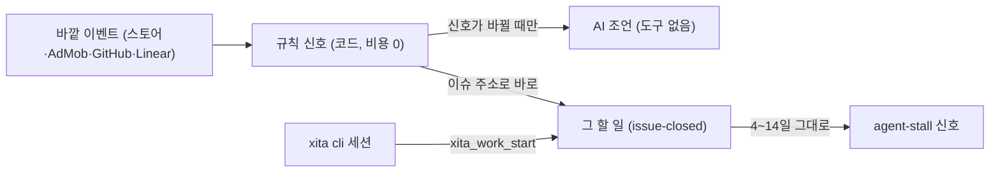

# XITA 에이전트 OS 도메인 지도

> 대상 사용자: 앱 여러 개를 혼자 운영하는 개발자(대장님 1인) · 수익 모델: 없음, 개인 도구 `[가정]` (관리 대상 앱의 AdMob 수익을 극대화하는 것이 목적) · 플랫폼: CLI, macOS 데스크톱, 모바일, 웹 콘솔 · 작성일: 2026-10-21 · 코드 동기화: 2026-11-01 (xita-app/core·desktop)
> `[가정]` 확인 안 된 전제 · `[추정]` 출처 없는 값 · `[확인 필요]` 출시 전 반드시 검증 · `모름` 도메인 공백
> `[코드: 경로]` 코드에서 확인 (`xita-app/…` 는 `~/workspace/xita-app` 기준 현행 코드, `apps/…`·`rust/…`·`macos/…` 는 옛 xita 저장소. 옛 경로는 2026-10-21 기록) · `[미구현]` 기획엔 있고 코드엔 없음

**워크플로우:** [workflow.html](./workflow.html)을 브라우저에서 열면 "말로 기록", "말로 배포", "먼저 조언"과 예외 4개 시나리오가 재생된다.

**방향 한 줄:** 사람은 상태만 보고 말로 시킨다. 에이전트는 말을 **작업 요청(Operation)**으로 바꾸고, 코어는 정책에 따라 자동 반영할지 승인을 받을지 정한다. 모든 화면(xita cli·xita 데스크탑·xita 웹·xita 모바일앱)은 같은 코어에 붙는 얇은 창이다.

**지금 코드 (2026-11-01):** Rust 데몬 `xitad` 하나가 세션·도구·workspace·포트폴리오 수집을 맡고, xita cli·xita 데스크탑·xita 웹이 HTTP·SSE로 붙는다. 말은 Operation 상태기계가 아니라 `xita_*` 기록 도구 호출로 바로 쓰이고, 쓰기마다 journal(`op_id`)이 남아 `xita_undo`로 되돌린다. 승인은 SHIPPED 이동과 도구 실행 모드(auto·ask·plan)에만 있다. xita 모바일앱은 아직 xitad에 붙지 않는다.

## 한눈 지도



## 렌즈 표

| 렌즈 | 내용 | 신뢰 | 출처 |
| --- | --- | --- | --- |
| 1. 주체 | 대장님(유일한 사람), 에이전트, 코어, 외부 실행 대상(Play·AdMob·커뮤니티), LLM 제공사, 코딩 에이전트(opencode·codex·claude code·qwen-code) | 높음 | [코드: xita-app/core/crates/xita-ws/src/agent.rs] |
| 2. 핵심 루프 | 말한다 → 기록·실행된다 → 대시보드로 확인 → 조언을 받는다 → 다시 말한다 | 높음 | [코드: xita-app/core/crates/xita-harness/src/work_tools.rs], [코드: xita-app/core/crates/xita-daemon/src/portfolio/mod.rs] |
| 3. 상태 수명주기 | 승인 요청(proposal kind ACTION: pending→approved→applied·failed·running / rejected / expired) + Change 상태(IDEA→PLAN→BUILD→REVIEW→SHIP_READY→SHIPPED) | 높음 | [코드: xita-app/core/crates/xita-domain/src/work.rs] |
| 4. 숫자 규칙 | 수집 주기, 재시도, 승인 만료, 자동 반영 기준, 신호 기준값 | 중간 | [코드: xita-app/core/crates/xita-harness/src/config.rs], [코드: xita-app/core/crates/xita-daemon/src/portfolio/advice.rs] |
| 5. 돈 흐름 | 들어옴: AdMob, Play 판매 보고서, 수동 판매 입력. 나감: LLM 구독·토큰, M5 전기, 스토어 수수료 | 중간 | [코드: xita-app/core/crates/xita-daemon/src/portfolio/revenue.rs], [코드: xita-app/core/crates/xita-daemon/src/portfolio/sales.rs] |
| 6. 예외·어뷰징 | 잘못 알아들음, 프롬프트 주입(홍보 댓글·웹 내용), 모델 전부 실패, 외부 실행 실패, 동시 수정 | 낮음 | 아래 표 |
| 7. 운영·CS | 1인. 사람이 할 일은 승인과 확인만. 키 갱신, 쿼터 소진 대응이 남음 | 중간 | 아래 표 |
| 8. 규제 | 스토어 정책, AdMob 무효 트래픽, 커뮤니티 홍보 규칙, LLM 제공사 데이터 정책 | 낮음 | [확인 필요] |
| 9. 고유 렌즈 | ① 에이전트 런타임(harness)과 모델 라우팅 ② 화면 배포·설치 형태 | 중간 | 조사 결과 |

## 1. 주체



- **사람은 대장님 한 명.** 권한·멀티 테넌트는 필요 없다. 데몬 인증은 `$XITA_HOME/daemon.token` Bearer 하나다 [코드: xita-app/core/crates/xita-daemon/src/main.rs]. "기기"는 동기화 요청의 `DeviceIdentity`(맥·iOS·안드로이드)로만 있고, 기기별 토큰은 `[미구현]` [코드: xita-app/core/crates/xita-ws/src/sync.rs].
- **코딩 에이전트는 별도 주체로 유지.** handoff 마크다운을 만들어 opencode·codex·claude code·qwen-code에 넘긴다(실행은 opt-in) [코드: xita-app/core/crates/xita-ws/src/agent.rs]. xita cli 자신도 `xita_work_start`로 handoff를 받아 일하고 `xita_work_finish`로 마친다 [코드: xita-app/core/crates/xita-harness/src/work_tools.rs].
- Play 업로드(배포)는 2026-11-02 옮겼다. 에이전트 요청은 승인 뒤 데몬이 실행한다 [코드: xita-app/core/crates/xita-daemon/src/portfolio/deploy.rs]. 홍보 게시는 아직 없다 `[미구현]`.

## 2. 핵심 루프


- 지금 코드의 한 바퀴: 말한다 → `xita_*` 도구가 workspace에 바로 쓰고 `op_id` 한 줄 보고 → xita 데스크탑이 같은 workspace를 보여 준다 → 데몬이 수집·규칙 신호·조언을 만든다 [코드: xita-app/core/crates/xita-harness/src/work_tools.rs], [코드: xita-app/core/crates/xita-daemon/src/portfolio/mod.rs].
- 첫 바퀴: 설치 직후 "내 프로젝트 보여줘" 한 마디로 현황이 나와야 한다. planner import는 옛 TS 서버에만 있고 옮기지 않았다 `[미구현]` [코드: xita-app/core/AGENTS.md].
- 할 일 진행 (2026-11-02): xita 데스크탑·xita 웹 '작업 시작' → 모델·effort 고르기 → xitad 가 PTY 에서 `xita chat -p -m -e "/work <id>"` 를 띄운다 → 제품 화면 '만드는 중'·'작업 보드'에서 그 터미널을 앱 안에서 본다. 실행 목록은 `$XITA_HOME/runs.json` 에 남아 데몬이 다시 떠도 할 일의 `agent_session` 으로 이어 간다 [코드: xita-app/core/crates/xita-daemon/src/runs.rs], [코드: xita-app/desktop/Sources/XitaManage/Views/WorkRuns.swift].
- 자가 관리 (2026-11-03): 수집 뒤 데몬이 스스로 출시·버전을 스토어 빌드에 맞추고, 출시된 할 일을 SHIPPED, AI 판정(확신 0.8 이상)으로 끝난·불필요 할 일을 정리, 별점 3 이하 리뷰와 효과 큰 조언을 할 일(IDEA)로 만든다. 모두 journal·`monitor/autopilot.jsonl` 에 남아 되돌릴 수 있다 [코드: xita-app/core/crates/xita-daemon/src/portfolio/autopilot.rs]. 첫 실행(2026-11-03): beamlink 0.12.0-beta.19 RELEASED·할 일 7개 SHIPPED, 제품 6개 버전 채움, 조언 할 일 1개. 같은 날 확장: 크래시·AI 코드 리뷰 결함 할 일, 주 1회 Play 경쟁 앱 조사(할 일 + 인사이트), 주 1회 GitHub 트렌딩·Show HN 에서 새 제품 아이디어(메모함 → 기획 위저드). 같은 날 2차: 경쟁 조사는 제품 문서(README·docs·planner 기획서)로 제품 성격·플랫폼·기능 검색어를 먼저 정리하고 Google Play·App Store·Mac App Store·웹(Aside 브라우저 에이전트)을 함께 본다. 새 제품은 App Store 한국 차트·Aside 웹 신호를 더한다. AI 일마다 섹션별 모델(`[portfolio.models]`: 할 일 정리·리뷰·코드 리뷰·경쟁 조사·새 제품·기획 위저드·정리 담당)을 고른다. 한 바퀴는 조사원들이 동시에 조사만 하고 정리 담당 하나가 겹치는 제안을 합쳐 한 번에 쓴다(실데이터 복사본 35분 → 7분, 그동안 AI 분석 24초에 끝남) [코드: xita-app/core/crates/xita-daemon/src/portfolio/models.rs].
- 다시 오는 이유: `refresh_hours`(기본 6시간) 수집 뒤의 조언과 규칙 신호 [코드: xita-app/core/crates/xita-daemon/src/portfolio/advice.rs].

## 3. 상태 수명주기

신규 핵심 객체 **Operation(작업 요청)**. 2026-11-02 구현은 둘로 나뉜다: 바로 쓰는 기록은 journal(되돌리기), 승인이 필요한 일(정책표)은 승인 요청 문서(`proposals` kind ACTION)가 상태기계다 [코드: xita-app/core/crates/xita-domain/src/approvals.rs]. 하나의 Operation 객체로 합치는 일은 `[미구현]`.



**지금 코드에 있는 것 (Operation 상태기계 대신):**

| 개념 | 실제 | 근거 |
| --- | --- | --- |
| 에이전트 쓰기 기록 | journal `{op_id, ts, summary, kind, id, before, undone}` → `.xita/agent-ops.jsonl`. 상태 필드 없이 `undone` 하나 | [코드: xita-app/core/crates/xita-domain/src/journal.rs] |
| 되돌리기 (Reverted) | `xita_undo`·`POST /v1/undo` 가 쓰기 전 내용을 새 리비전으로 복원, 새 문서면 삭제, `AGENT_UNDO` 이벤트 | [코드: xita-app/core/crates/xita-domain/src/journal.rs], [코드: xita-app/core/crates/xita-daemon/src/main.rs] |
| 자동 반영 / 승인 분류 (Classified) | 분류 단계 없음. 기록성 도구는 바로 쓰고, `NEEDS_APPROVAL = ["SHIPPED"]` 만 막는다 | [코드: xita-app/core/crates/xita-domain/src/work.rs] |
| 도구 실행 승인 | 모드 `auto`(기본)·`ask`·`plan`, 결정 Allow·Always·Remember·Deny. 업무 종류와는 무관 | [코드: xita-app/core/crates/xita-harness/src/permissions.rs] |
| xita 데스크탑 변경 | `OperationEngine` 판정 Safe·SafeNonOverlap·Conflict·Rejected, 결과 APPLIED·DEDUPED·CONFLICT·REJECTED | [코드: xita-app/core/crates/xita-ws/src/operation.rs] |

Change 수명주기: IDEA·PLAN·BUILD·REVIEW·SHIP_READY·SHIPPED·PAUSED·CANCELLED [코드: xita-app/core/crates/xita-domain/src/work.rs]. SHIPPED·CANCELLED가 끝 상태다. 같은 전이표가 `xita-domain`과 `xita-ws`에 따로 있다 [코드: xita-app/core/crates/xita-ws/src/lifecycle.rs].
- SHIPPED: 에이전트는 못 옮긴다(오류 "소유자 승인 필요"). 사람은 xita 데스크탑에서 REVIEW·SHIP_READY일 때 `POST /v1/ws/changes/{id}/approve`로 승인한다 [코드: xita-app/core/crates/xita-ws/src/operation.rs], [코드: xita-app/core/crates/xita-daemon/src/ws.rs].
- 승인 요청은 `proposals/` 문서(kind ACTION, `action`·`target`·`params`·`expires_ms`)이고, 만료는 24시간(`[approval] expire_hours`) [코드: xita-app/core/crates/xita-domain/src/approvals.rs].

## 4. 숫자 규칙

| 규칙 | 공식 후보 | 파라미터 | 기준값 | 설정값화 |
| --- | --- | --- | --- | --- |
| 수집·조언 주기 | A: 고정 N시간 / B: 신호 있을 때만 알림(침묵 규약) | `config.toml [portfolio] refresh_hours`, `advice_hours` | 수집 6시간(0이면 끔), 신호가 그대로면 24시간 안에는 AI 조언을 다시 받지 않음 [코드: xita-app/core/crates/xita-harness/src/config.rs], [코드: xita-app/core/crates/xita-daemon/src/portfolio/mod.rs]. OpenClaw heartbeat 기본 30분 ([docs.openclaw.ai/gateway/heartbeat](https://docs.openclaw.ai/gateway/heartbeat)) | 예 (구현) |
| 모델 실패 대기 | A: 고정 cooldown / B: 지수 백오프 | `[retry] attempts·base_ms·max_ms·jitter` | B 구현: 2회, 500ms→최대 10초, jitter 0.1, `Retry-After` 우선, 일시 오류 5종만. 그래도 실패한 턴은 모델 대체 순서의 다음 모델로 이어서 돌린다(결정 D4, 하네스 턴 단위, 기본 빈 목록. 순서는 `/fallback`·xita 데스크탑·xita 웹 설정에서 지정 → settings.toml `fallback`, 없으면 `[fallback] chain`) [코드: xita-app/core/crates/xita-harness/src/settings.rs] `fallback_chain`, [코드: xita-app/core/crates/xita-harness/src/config.rs], [코드: xita-app/core/crates/xita-harness/src/lib.rs] `fall_back` | 예 (구현) |
| 자동 반영 범위 | A: 종류별 정책표 / B: 모델 확신도 임계값 / C: A+B | 작업 종류, 확신도 | A 구현: `[approval] require = ["work.ship", "release.complete", "deploy"]`, 나머지 기록은 바로 쓰고 `xita_undo` [코드: xita-app/core/crates/xita-domain/src/approvals.rs] | 예 (구현) |
| 승인 만료 | A: 만료 없음 / B: N시간 후 만료 | 만료 시간 | B 구현: `[approval] expire_hours = 24`, 데몬이 30초마다 만료 처리 [코드: xita-app/core/crates/xita-daemon/src/approvals.rs] | 예 (구현) |
| 모델 창 크기 | A: provider 공통값 / B: 모델별 최대 | 모델별 컨텍스트 | B 구현 (2026-11-02 대장님 요청): models.dev `limit.context` — 같은 provider → 이름이 이어지는 provider → 과반 값, 없으면 공통값. `/context-window` 가 마지막에 덮는다 [코드: xita-app/core/crates/xita-harness/src/model_limits.rs] | 예 (구현) |
| 대화 → 기록 정리 시점 | A: 매 턴 / B: 대화 종료·N분 무응답 / C: 명시적 "정리해" | 대기 시간 | 추천 B+C `[가정]` | 예 |
| 루프·컨텍스트 설정값 | 설정 | `max_parallel`, `max_steps`, `[spill] max_inline_chars`, `[context] retain_ratio`, `[memory] index_max_chars`, `[product] brief_items` | 10, 0(무제한), 50,000자, 0.16, 25,000자, 15 [코드: xita-app/core/crates/xita-harness/src/config.rs] | 예 (구현) |
| xita cli 작업 정체 (`agent-stall`) | 고정 일수 | 정체 일수 | 4~14일 (15일부터는 기존 `stale`) [코드: xita-app/core/crates/xita-daemon/src/portfolio/advice.rs] | 아니오 (기존 규칙 신호와 같이 상수) |
| 가져온 이슈 상태 조회 | 수집마다 열린 할 일의 이슈만 | 한 번 최대 개수 | 30개, 동시 4개, 한 건 15초 제한. GitHub 토큰 없는 한도 시간당 60회 안쪽 [코드: xita-app/core/crates/xita-daemon/src/portfolio/mod.rs] | 아니오 |

주기별 하루 점검 횟수 = 24 / 주기(시간). AI 조언 호출은 신호가 바뀌었거나 `advice_hours`가 지났을 때만이라 이 값이 상한이다 [코드: xita-app/core/crates/xita-daemon/src/portfolio/mod.rs].



## 5. 돈 흐름

값은 상대 비율이 아니라 **구조만** 보이기 위한 동일 가중치다. 실제 금액은 30일 AdMob $0.33 [코드: workspace revenue 조회 결과, 2026-10-18 세션], 구독료는 `모름`.

```mermaid
sankey-beta
AdMob,"대장님 수익",10
"Play 판매 보고서·수동 판매","대장님 수익",10
"대장님 수익","LLM 구독 (z.ai·Alibaba)",6
"대장님 수익","M5 전기·장비",4
"대장님 수익","스토어 등록비·수수료",4
"대장님 수익",순이익,6
```

- **XITA 자체는 돈을 벌지 않는다** `[가정]`. 그래서 핵심 숫자는 "AI 비용 ≤ 늘어난 수익"이다. 옛 TS 서버에는 무료·로컬 우선 라우팅이 있었지만 [코드: apps/server/app/v4/ai_router.ts], 현행 코드에는 비용·민감도 기준 자동 라우팅이 없다 `[미구현]`. 조언 모델은 `advice_provider`로 고르고, 토큰 가격은 `pricing.rs`가 계산한다 [코드: xita-app/core/crates/xita-harness/src/pricing.rs].
- 들어오는 돈: AdMob(OAuth, `revenue/admob-daily.json`), Play 판매 보고서(Cloud Storage zip → `revenue/sales-daily.json`, 환불은 음수), 수동 판매 입력. 통화는 환산하지 않고 통화별로 더한다 [코드: xita-app/core/crates/xita-daemon/src/portfolio/sales.rs], [코드: xita-app/core/docs/PORTFOLIO.md].
- 유료 판매 앱도 제품 카드·상세·현황에서 추이를 본다 (2026-11-02): 제품 행 `sales`(가장 큰 통화의 7일·30일·일별)와 현황 `totals.sales_7d`(통화별). 판매 행은 대표·구성 패키지 모두로 제품에 잇는다. 광고(USD)와 판매를 합친 하나의 수익 숫자는 없다 (환율 미적용) [코드: xita-app/core/crates/xita-daemon/src/portfolio/sales.rs] `product_summaries`.
- 나중에 제품화한다면 결정 목록 #7.

## 데이터 모델



| 엔티티 | 저장 위치 | 만드는 단계 | 바꾸는 단계 | 민감 필드 |
| --- | --- | --- | --- | --- |
| Session (계획의 Conversation) | `$XITA_HOME/sessions/<id>/session.v1.jsonl` (append-only). 할 일의 `agent_session`으로 연결 [코드: xita-app/core/crates/xita-session/src/lib.rs] | say | 매 턴 | 대화 원문(수익·키가 섞일 수 있음). 밖으로 보내지 않는다 |
| Operation (journal + 승인 요청) | journal `.xita/agent-ops.jsonl` (op_id·before·undone) [코드: xita-app/core/crates/xita-domain/src/journal.rs] | propose, monitor | apply, exec, undo | 이전 내용 원문 |
| Product | `~/.xita-workspace/products` [코드: xita-app/core/crates/xita-domain/src/store.rs] | 기획 확정 | apply | 없음 |
| Change | `changes` (`agent_session`·`source_url` 포함) [코드: xita-app/core/crates/xita-domain/src/work.rs] | apply | apply, undo | 없음 |
| 그 밖의 기록 | `decisions`·`insights`·`milestones`·`releases`·`capabilities`·`readiness`·`workbench`(메모)·`reviews`·`references`·`dispatches`·`patches`·`artifacts` [코드: xita-app/core/crates/xita-domain/src/store.rs] | xita_* 도구, xita 데스크탑 | 같음 | 없음 |
| Approval (proposal kind ACTION) | `proposals` [코드: xita-app/core/crates/xita-domain/src/approvals.rs] | ask | approve, reject, expire, apply | 결과 메모 |
| Event | `.xita/events.jsonl` (에이전트는 `eventType`, xita-ws는 `event_type` — 필드명이 둘) [코드: xita-app/core/crates/xita-domain/src/store.rs], [코드: xita-app/core/crates/xita-ws/src/operation.rs] | 모든 변경 | 없음(추가만) | 없음 |
| WorkRun (작업 실행) | 데몬 메모리 + `$XITA_HOME/runs.json` (id·change·cwd·provider·model·effort·command·exited) [코드: xita-app/core/crates/xita-daemon/src/runs.rs] | 작업 시작 | 끝남·닫기·데몬 재시작 때 이어 띄우기 | 없음 (터미널 출력은 메모리 256KB만) |
| Metric | `monitor/facts.json`(수집 캐시, `issues` 포함)·`revenue/` [코드: xita-app/core/crates/xita-daemon/src/portfolio/mod.rs] | monitor | monitor | 수익 (조언에는 수치만, 키·경로·코드는 빼고 보낸다) |

## 6~8. 예외·운영·규제

| 렌즈 | 항목 | 대응 | 출처 |
| --- | --- | --- | --- |
| 예외 | 잘못 알아들어 엉뚱한 프로젝트에 기록 | 쓰기마다 journal, `xita_undo`로 되돌리기 + 한 줄 보고(`op_id`) [코드: xita-app/core/crates/xita-domain/src/journal.rs] | 코드 |
| 예외 | 프롬프트 주입: 홍보 댓글·웹 페이지·커밋 메시지 속 지시 | 외부 텍스트는 데이터로만 다루고, 외부 작업은 항상 승인. 지금: 조언 경로는 도구 없이 수치만 받는다. 대화 경로 도구 모드 기본값은 `auto`(묻지 않음) [코드: xita-app/core/crates/xita-harness/src/config.rs] | [확인 필요] |
| 예외 | 모델 전부 실패 (M5 꺼짐, 쿼터 소진) | 계획: 체인 대체 → 규칙 모드. 지금: 대화는 재시도 뒤 사용자가 정한 모델 대체 순서로 이어 가고(빈 목록이면 오류), 기획 위저드도 같은 체인 뒤 기본 질문, 조언은 규칙 신호로 대체(`source: "rule"`) [코드: xita-app/core/crates/xita-harness/src/lib.rs], [코드: xita-app/core/crates/xita-daemon/src/portfolio/mod.rs] | 2026-10-18 실측: Alibaba 쿼터 소진 시 xal 300초 대기 |
| 예외 | 여러 화면에서 동시 수정 | 문서 `revision`, `.xita/workspace.lock`(xita-domain·xita-ws 공용), 충돌은 `.xita/conflicts.jsonl` [코드: xita-app/core/crates/xita-ws/src/operation.rs] | 코드 |
| 예외 | 작은 로컬 모델의 tool calling 불안정 | 기록·분류는 로컬, 복잡한 계획은 z.ai, 실패 시 확인 질문 | [확인 필요] PoC |
| 예외 | 가져온 GitHub·Linear 이슈는 닫혔는데 할 일은 IDEA·PLAN·BUILD·PAUSED | 수집 때 이슈 주소(`source_url`)로 상태를 보고 `issue-closed` 신호. 할 일은 자동으로 고치지 않는다 [코드: xita-app/core/crates/xita-daemon/src/portfolio/integrations.rs] | 2026-11-01 실측(GitHub 공개 이슈). Linear 실호출은 미검증 |
| 운영 | xita cli 가 시작한 할 일(`xita_work_start`)이 마무리 없이 멈춤 | `agent-stall` 신호 (BUILD 로 4~14일) [코드: xita-app/core/crates/xita-daemon/src/portfolio/advice.rs] | 2026-11-01 실측 |
| 운영 | 키·로그인 만료 (opencode CLI 키 만료 확인됨) | `xita connect`·`/v1/providers`가 키 상태 표시, 키는 `$XITA_HOME/auth.toml`(0600)·키체인 [코드: xita-app/core/crates/xita-harness/src/connect.rs], [코드: xita-app/core/crates/xita-harness/src/secrets.rs] | 2026-10-18 실측 |
| 운영 | 이미 출시했는데 출시 기록·할 일이 미출시로 남음 | 자가 관리가 Play production versionCode 로 출시를 RELEASED, 그 할 일을 SHIPPED, 제품 버전 갱신. 정책표 승인 대신 스토어 사실을 근거로 하고 되돌리기 가능 [코드: xita-app/core/crates/xita-daemon/src/portfolio/autopilot.rs] `sync_releases` | 2026-11-03 실데이터 첫 실행 |
| 운영 | 데몬이 다시 뜨면(업데이트·재부팅·비정상 종료) 작업 터미널이 끊김 | 끝나지 않은 실행을 같은 id 로 다시 띄우고, xita 실행은 할 일의 `agent_session` 을 `-s` 로 이어 "끊긴 곳부터 계속" 을 보낸다. 화면은 20초 동안 다시 붙는다 [코드: xita-app/core/crates/xita-daemon/src/runs.rs] | 2026-11-02 디버그 데몬 재시작 실측 (명령 실행). xita 세션 이어 가기는 단위 테스트만 |
| 운영 | 외부 서비스(GitHub·Linear) 끊은 뒤 다시 연결 안 됨 | 출처를 id(`env`·`file`·`keychain`·`gh`)로 싣고, 끊기는 auth.toml·키체인 모두 지우며 남는 출처(환경변수·gh 로그인)를 알려 준다 [코드: xita-app/core/crates/xita-daemon/src/portfolio/integrations.rs] | 2026-11-02 소유자 제보 |
| 운영 | xita 데스크탑 제품 채팅 탭에서 앱 종료 | SwiftUI 분할 보기(`.inspector`·`HSplitView`·`VSplitView`)가 레이아웃 갱신 중 AppKit 예외 → 제품 화면에서 분할 보기를 걷고 가로 배치 + 끌어서 폭 조절 [코드: xita-app/desktop/Sources/XitaManage/Views/ProductWorkspace.swift] | 2026-10-31·11-02 크래시 보고 (앱 코드 없는 SplitViewChildController 예외). 재현 테스트로는 안 잡힘 |
| 운영 | 상시 실행: 세션 끝나면 서버도 꺼짐 | `xitad install` → LaunchAgent `app.xita.xitad`(RunAtLoad·KeepAlive). Xita.app이 열릴 때 등록·복구 [코드: xita-app/core/crates/xita-daemon/src/main.rs], [코드: xita-app/desktop/Sources/Xita/Setup.swift] | 2026-11-01 코드 확인 |
| 운영 | 다른 기기·모바일 원격 접속 | 데몬이 127.0.0.1:4317 에 더해 이 맥의 Tailscale 주소(100.x:4317)에도 붙는다 (소유자 결정 2026-11-03: Tailscale 만, 같은 와이파이·인터넷은 안 염). `daemon.token` 하나, 작업 터미널은 xita 웹이 켜져 있을 때만 다른 기기 허용. 밖에서 온 대화 세션은 무인 실행(셸 꺼짐). 기기 토큰·xita 모바일앱 클라이언트는 `[미구현]` [코드: xita-app/core/crates/xita-daemon/src/main.rs] `spawn_tailscale` | 2026-11-03 실측: 설치 데몬이 100.71.101.6:4317 에서 듣고, 토큰 없이 401·웹 끄면 작업 터미널 403 |
| 규제 | 스토어 업로드·심사 정책 | 에이전트 업로드는 항상 승인, 사람이 시작하는 프로덕션은 제품 id 재입력. 기본 트랙 internal, 프로덕션은 초안(심사 제출은 `submit` 일 때만, 출시 이력 없는 앱은 초안으로 되돌림). 소유자 도구 planner `deploy.py` 와 같다 [코드: xita-app/core/crates/xita-daemon/src/portfolio/deploy.rs] | planner `docs/deploy-setup.md`·`new-app-playbook.md`. 실제 업로드는 미실행 (트랙 조회만 2026-11-03 실측) |
| 규제 | AdMob 무효 트래픽(본인 클릭·테스트 광고) | 테스트 광고 신호 감지 (`test-ads`) [코드: xita-app/core/crates/xita-daemon/src/portfolio/advice.rs] | [확인 필요] AdMob 정책 |
| 규제 | 커뮤니티별 홍보 규칙 | 자동 게시 금지, 규칙은 대장님이 입력. 홍보 초안 기능은 옮기지 않았다 `[미구현]` [코드: xita-app/core/AGENTS.md] | [확인 필요] 각 커뮤니티 |
| 규제 | 외부 LLM으로 보내는 데이터 | 계획: 민감 작업은 로컬 provider만 (민감도 라우팅 `[미구현]`). 지금: 조언에 키·경로·코드를 빼고 보낸다, 세션 로그는 밖으로 안 보낸다 [코드: xita-app/core/AGENTS.md] | [확인 필요] z.ai·opencode 무료 모델 데이터 정책 |

## 9. 고유 렌즈

### 9-1. 에이전트 런타임 (뼈대)

XITA 에이전트는 **코딩 에이전트가 아니라 도메인 에이전트**다. 필요한 도구는 bash·파일 편집이 아니라 `xita_work_add`, `xita_deploy`, `xita_revenue` 같은 XITA API다. 이미 MCP 도구가 일부 있다 [코드: apps/cli/xita-mcp.mjs].

**결과 (2026-11-01 코드):** 결정 #2 A안대로 프레임워크 없이 만들었다. rig-core·async-openai·rmcp는 쓰지 않고, `xita-llm`이 reqwest로 adapter(openai-chat·openai-responses·anthropic·claude-cli·opencode-cli)를 직접 구현한다. MCP 클라이언트도 직접 구현했다 [코드: xita-app/core/crates/xita-llm/src/lib.rs], [코드: xita-app/core/crates/xita-harness/src/mcp.rs]. 도메인 도구는 `xita_projects`와 `xita_*` 기록 도구 15종이다(`xita_deploy`·`xita_revenue`는 없음) [코드: xita-app/core/crates/xita-harness/src/tools.rs], [코드: xita-app/core/crates/xita-harness/src/work_tools.rs]. 자가개선용 파일·셸·검색·웹 도구도 함께 있다.

| 후보 | 언어·라이선스 | Chat Completions 호환 (LiteLLM·GLM) | 붙이는 방식 | 판단 |
| --- | --- | --- | --- | --- |
| **pi** (earendil-works/pi, 구 badlogic/pi-mono) | TS · MIT | ○ `openai-completions` + baseUrl | 라이브러리로 내장 (`createAgentSession`, customTools, JSONL 세션), pi-tui | TS로 갈 때의 1순위였음. core를 Rust로 정해 설계 참고만 (provider `compat`·세션 JSONL 구조) |
| **opencode** (anomalyco/opencode) | TS · MIT | ○ z.ai·Ollama 공식, 무료 Zen 모델 | 별도 서버 `opencode serve` + SDK | 설계 참고. 완성도 최고지만 코딩용 기본값을 걷어내야 하고, XITA 옆에 **서버가 하나 더** 생긴다. 릴리스가 매우 잦다 |
| Vercel AI SDK | TS · Apache-2.0 `[추정]` | ○ `@ai-sdk/zai`, openai-compatible | 루프 직접 조립 | 대안. 세션·압축·TUI를 다 만들어야 한다 |
| Codex CLI (codex-rs) | Rust · Apache-2.0 | ✕ `wire_api="chat"` 제거됨, Responses 전용 | app-server (experimental), crates.io 미배포 | 탈락. z.ai·Alibaba·Zen chat 엔드포인트 못 씀 |
| Claude Agent SDK | Anthropic 상용 약관 | ✕ | SDK | 탈락. Claude 전용 |
| DeepSeek Harness ("dsv harness" 추정) | TS(Node ≥22.19) · MIT | ○ (내부적으로 pi-ai 사용) | web·headless(NDJSON)·SDK(stdio JSON-RPC)·ACP, Electron. **TUI 없음** | 설계 참고만. 패키지 약 300개를 Cordis 플러그인으로 조립, 0.2.1-rc.2, 30일 커밋 약 3,261개, SAFETY.md에 "production-ready 아님". 상주 메모리 수백 MB `[추정]` |
| **rig-core** (Rust) | Rust · MIT | ○ OpenAI 호환 base_url `[추정: 세부 API 미확인]` | 라이브러리 (axum 데몬에 내장), MCP는 `rmcp` | **Rust로 갈 때 1순위.** 0.45.0 (2026-10-19) |
| async-openai (Rust) | Rust · MIT | ○ `with_api_base` | 라이브러리, 루프는 직접 (약 300줄 `[추정]`) | rig 대안 |
| Goose 크레이트 (Rust) | Rust · Apache-2.0 | ○ openai_compatible | `goose-sdk` 0.1.0-alpha.12 | alpha. 정식판 나오면 재검토 |
| Goose | Rust · Apache-2.0 | ○ | ACP, REST | 대안. 커스텀 배포판 가능하지만 Rust |
| Crush | Go · FSL-1.1 | ○ `[추정]` | CLI | 탈락. 라이선스 |

출처: [github.com/earendil-works/pi](https://github.com/earendil-works/pi), [opencode.ai/docs/server](https://opencode.ai/docs/server/), [opencode.ai/docs/providers](https://opencode.ai/docs/providers/), [learn.chatgpt.com/docs/config-file/config-reference](https://learn.chatgpt.com/docs/config-file/config-reference), [code.claude.com/docs/en/agent-sdk/overview](https://code.claude.com/docs/en/agent-sdk/overview), [github.com/deepseek-ai/deepseek-harness](https://github.com/deepseek-ai/deepseek-harness), [github.com/charmbracelet/crush LICENSE](https://github.com/charmbracelet/crush/blob/main/LICENSE.md). 스타·릴리스 날짜는 2026-10-21 `gh api` 조회.

- "opencodex"는 같은 이름의 활성 프로젝트가 없다. opencode를 말씀하신 것으로 보고 정리했다 `[추정]`.
- "dsv harness"도 정확히 일치하는 게 없다. DeepSeek Harness(`dsh`)로 추정 `[추정]`.

**xal은 무엇으로 만들었나** (바이너리 분석 + 저장소 확인, 2026-10-21)
- **TS 루프·화면 + Rust 네이티브 애드온 하이브리드.** 저장소 `github.com/xal-sh/xal`: `packageManager: bun@1.3.14`, `@opentui/core ^0.5.1`, Rust 크레이트 `xal-native`, 빌드는 `scripts/native/build.ts`에서 `bun build --compile` (실행 파일 안에는 Bun v1.4.0 런타임 문자열). arm64 94MB, 0.1.0-beta.256.
- 화면은 **OpenTUI**: Zig 네이티브 코어 + TS 바인딩, 0.6.6, MIT. Bun ≥1.3.14 또는 Node ≥26.4(`--experimental-ffi`) 필요. opencode가 실서비스에 쓴다. 출처: [github.com/anomalyco/opentui](https://github.com/anomalyco/opentui).
- opencode 포크는 아니다. AI SDK(`@ai-sdk/*`) 흔적이 없고 자체 플러그인 구조(`registerTool`·`registerProvider`·`registerCommand`·`registerHook`·`registerPrompt`), MCP 클라이언트, skills, subagent, compaction, goal 루프를 가진 독자 harness다.
- **xal 방식으로 만들려면:** Bun + TypeScript로 루프·화면을 짜고 `@opentui/core`(또는 `@opentui/react`·`@opentui/solid`)로 그린 뒤 `bun build --compile`로 묶는다. 무거운 부분만 Rust 애드온으로 뺀다. 크로스 빌드 전 `bun install --os="*" --cpu="*" @opentui/core@<ver>`, Linux는 `OPENTUI_LIBC` 지정 필요.
- **Rust 코어와 섞으면:** 루프는 Rust 데몬, OpenTUI는 화면 전용 클라이언트(HTTP·SSE)로 둘 수 있다. 대가는 Bun 런타임이 실행 파일에 들어가 60~100MB `[추정]`. 순수 Rust로 가면 **ratatui**(Codex TUI가 사용, 0.30.2, 실행 파일 수 MB `[추정]`).

### 9-2. 설치 형태와 화면 배치



- **레퍼런스가 한 방향을 가리킨다.** opencode(서버 하나에 TUI·데스크톱·SDK가 붙음), Codex(app-server를 IDE·데스크톱이 공유), OpenClaw(게이트웨이 하나에 CLI·웹·macOS·모바일·메신저), Claude Code(모바일은 로컬 세션에 붙는 창). 출처: [opencode packages](https://github.com/anomalyco/opencode/tree/dev/packages), [developers.openai.com/codex/app-server](https://developers.openai.com/codex/app-server), [docs.openclaw.ai](https://docs.openclaw.ai/), [code.claude.com/docs/en/mobile](https://code.claude.com/docs/en/mobile).
- **2026-11-01 코드:** brew cask가 Xita.app을 깔고, 앱 안의 xita·xitad를 PATH에 링크한다. 앱이 열릴 때 `xitad install`로 LaunchAgent를 등록·복구한다(`SMAppService`는 쓰지 않음). xita cli와 xita 데스크탑은 `127.0.0.1:4317`에 HTTP·SSE·Bearer로 붙는다(Unix 소켓 아님). 데몬이 없으면 xita cli는 혼자 돈다 [코드: xita-app/core/Casks/xita.rb], [코드: xita-app/desktop/Sources/Xita/Setup.swift], [코드: xita-app/core/crates/xita-cli/src/backend.rs].
- **할 일 진행 화면 (2026-11-02):** 제품 화면 머리를 고정 헤더로 두고 '현황 | 만드는 중 | 채팅' 과 분석·정보·더보기·사이드바를 한 자리에 둔다. '만드는 중' 과 사이드바 '작업 보드'(xita 데스크탑·xita 웹)가 xitad `/v1/runs` 터미널을 보여 준다. 작업 터미널은 다른 기기(Tailscale)에서도 토큰 + xita 웹 켜짐이면 보고 시킨다 [코드: xita-app/desktop/Sources/XitaManage/Views/ProductDetailView.swift], [코드: xita-app/core/crates/xita-daemon/web/app.js] `boardPage`.
- **코어가 둘이던 문제:** xita 데스크탑은 이제 Rust를 링크하지 않고 `/v1/ws/*` HTTP로만 붙는다 [코드: xita-app/desktop/Package.swift]. 남은 것은 Rust 안의 `xita-domain`(에이전트 도구용)과 `xita-ws`(xita 데스크탑용)가 같은 파일 형식을 다른 코드로 쓰는 것이다. 합치기는 남은 일이다 [코드: xita-app/core/AGENTS.md].
- **(2026-10-21 기록) 현재 XITA는 코어가 둘이다.** TS 서버 [코드: apps/server/app/v4/] 와 Rust 코어 [코드: rust/xita-core/src/] 가 같은 workspace를 각각 쓴다. 데스크톱은 Rust 라이브러리를 절대경로로 링크한다 [코드: macos/XitaApp/Package.swift]. 실제로 이벤트 필드명이 `eventType`과 `event_type`으로 갈라진 흔적이 있다 [코드: apps/server/app/v4/ops.ts]. 15종 타입 parity를 손으로 맞춰야 한다 [코드: rust/xita-core/src/storage.rs].

**현재 자원 사용 실측** (2026-10-21, 샌드박스 서버, 개발 모드 `node ace serve`): 상주 메모리 2개 프로세스 합계 **403MB**, 기동 후 첫 응답까지 30초 이상(ts-node 컴파일 포함), 제품 목록 API 응답 약 4ms. 체감 지연의 대부분은 모델 응답(2026-10-18 실측 0.4초~20초)이다. Rust 전환의 실익은 **상주 메모리·유휴 CPU·기동 시간·단일 실행 파일 배포**이고, API 지연은 이미 충분히 짧다. 프로덕션 빌드 Node의 메모리는 측정하지 않았다.

**Rust 전환 뒤 실측** (2026-11-01, 설치된 0.1.0-beta.53, 가동 27분·유휴): `xitad` 상주 메모리 약 **49MB**(`ps` RSS 50,080KB). 실행 파일은 xita 8.9MB, xitad 10.7MB. 응답 지연과 대화 중 메모리는 측정하지 않았다.

### 9-3. 뼈대와 하네스의 경계

xita CLI는 대장님의 하네스와 작업 철학을 담는 그릇이다. 코드에는 **바뀌지 않는 기초만** 넣고, 판단과 성격은 실행 시 읽는 하네스 층에 둔다.



- 확장 지점은 xal의 `registerTool`·`registerProvider`·`registerCommand`·`registerHook`·`registerPrompt`와 같은 범위로 잡는다. 이 이상은 뼈대에 넣지 않는다.
- **2026-11-01 코드:** 커널 확장 지점은 `Tool`(Registry)과 `Hook` 4개(`on_request_error`·`pre_tool`·`post_tool`·`on_stop`)다 [코드: xita-app/core/crates/xita-loop/src/lib.rs]. 하네스 폴더(`$XITA_HOME/harness`, `harness_dirs`)는 `AGENTS.md`·`CLAUDE.md`·`rules/*.md`, `skills/<이름>/SKILL.md`, `hooks.toml`·`hooks.d/*.toml`(이벤트 session_start·prompt·pre_tool·post_tool·stop·turn_end·notification, exit 2 = 차단, Claude Code 호환 payload), `policy.toml`(`[tools] deny`)을 읽는다 [코드: xita-app/core/crates/xita-harness/src/kit.rs]. 설정 층은 내장 → `config.toml` → `profiles/<이름>.toml` → `--patch`이고, 화면이 쓰는 값은 `settings.toml`로 분리했다 [코드: xita-app/core/crates/xita-harness/src/config.rs], [코드: xita-app/core/crates/xita-harness/src/settings.rs]. 기억은 `$XITA_HOME/memory/{projects,global}`이다 [코드: xita-app/core/crates/xita-harness/src/memory.rs].
- 하네스 정의 형식은 결정 #9 (구현: 정책은 YAML이 아니라 TOML).

### 9-4. CLI 개발 철학: DeepSeek Harness를 따른다 (2026-10-21 대장님 결정)

출처: [github.com/deepseek-ai/deepseek-harness](https://github.com/deepseek-ai/deepseek-harness)의 `AGENTS.md`, `docs/architecture.md`, `.agents/notes/implemented/architecture/*` (master, 2026-10-17). 문서 기준이고 소스는 직접 읽지 않았다. **저장소에 terminal-bench·SWE-bench 점수는 없다.** "성능이 가장 좋다"는 저장소로는 확인되지 않으며, 따라 할 근거는 아래 설계 원칙이다.

| dsh 원칙 | 뜻 | xita 적용 | 위치 |
| --- | --- | --- | --- |
| Model-visible ⟺ logged | 모델에 간 요청은 로그만으로 바이트 단위 재구성 가능 | append-only 세션 이벤트 + 순수 함수 projection으로 메시지 생성 | 뼈대 |
| 캐시 안정성은 결과로 생긴다 | 위 원칙을 지키면 prefix cache가 자동 유지 | 헤더(설정·도구 스키마)는 바뀔 때만 기록, 프롬프트 변경은 history 뒤에 append. 두 번째 요청부터 cache-read > 0 테스트 | 뼈대 |
| Plugins, not loop changes | 새 동작은 확장 지점에만 | turn/step 이벤트 + 훅 체인(pre-step, request, request-error, tool pre/execute/post) | 뼈대 |
| 병렬 도구 + exclusive barrier | 안전한 호출은 최대 10개 동시, 판단 불가면 exclusive | `trait Tool { concurrency() }` + tokio semaphore | 뼈대 |
| 실패해도 짝을 맞춘다 | 취소·실패 시 도구 결과를 합성 (`TOOL_OUTCOME_UNKNOWN` 등), 결과 불확실한 작업은 자동 재시도 금지 | 루프 복구 모듈 | 뼈대 |
| 세션 버전 = 정수 하나 | `session.vN.jsonl`, 인접 migration, 미래 버전 거부, 이벤트 추가는 `ignorable` | 세션 저장 모듈 | 뼈대 |
| No hardcoded tunables · fails loud · explicit | 바뀌는 값은 검증되는 설정, 잘못된 설정은 바로 에러 | 설정 로더 | 뼈대 |
| profile = bundle 층 + patch | 구성을 층으로 쌓고 row id로 교체·삽입, `--dump-config` | 하네스 정의(결정 #9)를 이 방식으로 | 뼈대(로더) / 하네스(내용) |
| 재시도·compaction·spill·sandbox·승인 | 전부 선택형 seam | 재시도(transient 5종, 2회), compaction(80% 또는 W−출력−64k, 16% 보존), 12.5k 토큰 넘는 결과 spill | 하네스 |
| 최소 도구 구성 | 벤치용 `sdk-minimal`: 페르소나 한 줄 + 도구 3개 | xita 기본 프로필도 최소 도구로 시작 | 하네스 |
| PTC (`run_code`) | 도구 호출 대신 코드로 여러 도구를 묶어 실행 | 후순위 | 하네스 |
| 문서마다 "Model Experience" | 모든 모듈이 토큰·KV 캐시 영향을 적는다 | crate README 규칙 | 프로세스 |

- **따라 하지 않을 것:** dsh는 세션 로그를 DeepSeek로 업로드하는 기능이 기본으로 켜져 있다(`2026-09-14-session-log-upload-default.md`). xita는 로그를 밖으로 보내지 않는다.
- 이 원칙들의 정본은 `xita-app/core/AGENTS.md`의 12개 원칙이다 [코드: xita-app/core/AGENTS.md].
- **차이:** dsh는 TypeScript/Node + Cordis이고 "특권 core 없음"이다. xita는 Rust로 같은 경계를 crate와 trait으로 만든다. 플러그인은 동적 로딩 대신 하네스 파일(프로필·훅 실행 파일)로 갈아 끼운다.

### 9-5. Super-agent 설계 대조 (2026-11-01)

출처: DeepSeek Harness 팀 아티클 "Exploring Super-agent Design: Towards a More Autonomous Agent System" ([x.com/DeepSeekHarness/status/2116857257245987236](https://x.com/DeepSeekHarness/status/2116857257245987236), 2026-11-01, 중국어 원문의 기계 번역). dsh 기능 소개가 아니라 설계 제안이고, 실험은 합성 워크로드라 원문도 "참고용"이라고 밝힌다.

글의 요지: 단일 작업의 병목은 모델이 아니라 사람의 주의력이다(동시에 따라가는 세션 3~5개). 그래서 상시 실행 Router(대화·배분만) + 격리된 Worker, 이벤트 구동(Fast/Slow 필터·Thread 구독), Inline & Spill·Chain of Recall, 비동기 도구, 채널별 말투, 연산·상태·환경 분리, 진척을 보는 Watchdog을 제안한다.



| 원문 원칙 | XITA 현재 | 근거 | 판단 |
| --- | --- | --- | --- |
| Router는 실행하지 않고 Worker가 실행 | 조언 경로는 도구 없이 수치·신호만 받는다. xita cli는 헬퍼이자 자가개선 도구라 파일·셸 도구를 쓴다 | [코드: xita-app/core/crates/xita-daemon/src/portfolio/advice.rs] `PORTFOLIO_SYSTEM`, [코드: xita-app/core/crates/xita-harness/src/lib.rs] | 적용 안 함. xita cli에서 실행 도구를 빼면 기존 기능이 깨진다 |
| Fast/Slow 필터 | 규칙 신호를 먼저 계산하고, `signals_hash`가 같고 `advice_hours` 안이면 AI를 부르지 않는다 | [코드: xita-app/core/crates/xita-daemon/src/portfolio/mod.rs] `run_analysis` | 이미 있음 |
| Thread 구독·pass-through | **이번 적용.** 가져온 이슈(`source_url`)의 상태를 수집 때 주소로 조회해 그 할 일에 `issue-closed` 신호를 붙인다. AI를 거치지 않는다 | [코드: xita-app/core/crates/xita-daemon/src/portfolio/integrations.rs] `issue_state`, [코드: xita-app/core/crates/xita-daemon/src/portfolio/mod.rs] `tracked_issues` | 적용 (e72b39e) |
| Inline & Spill · Chain of Recall | 긴 도구 결과는 page로 빼고 `context_recall`로 다시 읽는다. 새 세션에 연결 제품 요약을 넣고, 할 일에 `agent_session`을 남긴다 | [코드: xita-app/core/crates/xita-harness/src/hooks.rs], [코드: xita-app/core/crates/xita-harness/src/work_tools.rs] | 이미 있음 |
| 전이중 (`start`/`stop`) | `shell` background + `job_output`·`job_kill`, 끝나면 다음 메시지에 알림. TUI는 응답 중에도 steer·queue를 받는다 | [코드: xita-app/core/crates/xita-harness/src/jobs.rs], [코드: xita-app/core/crates/xita-cli/src/tui.rs] | 이미 있음 |
| 채널별 응답 규약 | 화면(xita cli·데스크탑·웹·모바일앱)마다 말투를 나누지 않는다 | 모름 (하네스 층 결정) | 결정 #10 |
| 연산·상태·환경 분리, BYOM | 이 맥의 `xitad` 하나가 상태를 갖고 화면들이 붙는다. 클라우드 루프는 없다 | [코드: xita-app/core/crates/xita-daemon/src/main.rs] | 적용 안 함. 1인 로컬 도구라 공격면만 늘어난다 |
| Watchdog | 생존은 LaunchAgent `KeepAlive`. **이번 적용:** xita cli가 시작한 할 일이 BUILD로 4~14일 그대로면 `agent-stall` 신호 (15일부터는 기존 `stale`) | [코드: xita-app/core/crates/xita-daemon/src/main.rs] plist, [코드: xita-app/core/crates/xita-daemon/src/portfolio/advice.rs] | 적용 (e72b39e) |
| 먼저 해두기 (speculative) | 없음 | | 보류. 토큰 비용이 "AI 비용 ≤ 늘어난 수익"과 부딪친다 |
| 자격증명은 모델이 못 보게 | 조언에 보내는 제품 요약에서 키·경로·코드를 뺀다. 연동 토큰은 응답에 싣지 않는다 | [코드: xita-app/core/crates/xita-daemon/src/portfolio/advice.rs] `product_facts`, [코드: xita-app/core/crates/xita-daemon/src/portfolio/integrations.rs] | 이미 있음 |

## 저장소 구조

대장님 제안: Xita 조직 + `cli`·`desktop`·`mobile` 저장소 분리, core 여부. **core를 Rust로 확정한 기준**으로 정리.

| 안 | 구성 | 장점 | 단점 |
| --- | --- | --- | --- |
| A. 4개 분리 | core, cli, desktop, mobile | 대장님 원안 | cli는 core 크레이트(프로토콜·도메인 타입)를 그대로 쓰므로 나누면 버전 맞추기만 늘어난다 |
| **B. 3개 (추천)** | `xita`: Cargo workspace(`crates/core`·`protocol`·`gateway`(xitad)·`cli`(ratatui)) + 웹 콘솔 정적 파일 / `desktop`: SwiftUI / `mobile`: Expo | 언어·릴리스 주기가 다른 것만 나눈다. desktop·mobile은 `protocol`이 내보내는 스키마(OpenAPI·JSON Schema)로 생성한 클라이언트만 쓴다 | 프로토콜 버전 관리와 계약 테스트 필요 |
| C. 1개 모노레포 | 위 전부 한 저장소 | 한 커밋으로 원자적 변경 | Cargo·SwiftPM·Expo 혼합 CI |

**2026-11-01 실제:** 조직 `xita-app`에 `core`(Cargo workspace: xita-llm·xita-session·xita-tools·xita-loop·xita-harness·xita-domain·xita-ws·xita-daemon·xita-cli, 웹 정적 파일, `Casks/`, `scripts/release.sh`), `desktop`(SwiftUI), `homebrew-tap`이 있다. `mobile` 저장소와 `protocol` crate는 없다. 옛 `xita` 저장소(TS 서버·옛 macOS 앱·문서)는 참고용이다 [코드: xita-app/core/Cargo.toml], [코드: xita-app/core/AGENTS.md].

**core는 둔다. 단 하나, Rust로.** CLI는 core와 같은 저장소에 둔다. desktop·mobile은 core를 링크하지 않고 게이트웨이 프로토콜(HTTP·SSE)로만 붙는다. 지금처럼 데스크톱이 Rust 라이브러리를 절대경로로 링크하는 방식은 걷어낸다 [코드: macos/XitaApp/Package.swift]. (2026-11-01 완료: xita 데스크탑은 HTTP로만 붙는다 [코드: xita-app/desktop/Package.swift])

## 레퍼런스 대조

O 있음 · △ 부분 · 빈칸 없음/확인 못 함. 출처는 위 9장과 [linear.app/docs/pulse](https://linear.app/docs/pulse), [linear.app/developers/agents](https://linear.app/developers/agents), [plane.so 자체 호스팅 AI](https://plane.so/blog/plane-ai-is-coming-to-self-hosted-deployments).

| 항목 | XITA 기획 | OpenClaw | Linear | Plane | opencode |
| --- | --- | --- | --- | --- | --- |
| 자연어로 작업 생성·수정 | O (신규) | △ | O | O | |
| 대화 → 기록 자동 정리 | O (신규) | △ 세션·메모리 | O | △ | △ 세션 요약 |
| 상태 대시보드 | O xita 데스크탑·xita 웹 [코드: xita-app/desktop/Sources/XitaManage], [코드: xita-app/core/crates/xita-daemon/web/app.js] | △ | O Pulse | O | |
| 여러 화면이 한 서버 공유 | O xitad [코드: xita-app/core/crates/xita-daemon/src/main.rs] | O | O | △ | O |
| 위험 작업 승인 게이트 | O 정책표 `[approval]` + 승인 대기열(만료 24시간) [코드: xita-app/core/crates/xita-daemon/src/approvals.rs] | △ 도구 정책 | △ | | O 권한 요청 |
| 주기 점검·먼저 알림 | O [코드: xita-app/core/crates/xita-daemon/src/portfolio/mod.rs] | O heartbeat | O Pulse | | |
| 침묵 규약 (알릴 게 없으면 조용) | △ 신호가 같으면 AI를 다시 부르지 않음, 알림 규약은 `[미구현]` | O `NO_REPLY` | | | |
| 메모리 (선호·맥락 장기 기억) | O `memory_*` 도구 [코드: xita-app/core/crates/xita-harness/src/memory.rs] | O | | | △ |
| 메신저 연동 (텔레그램 등) | `[미구현]` 누락 후보 | O | O Slack | | |
| 수익·지표 연동 | O AdMob·Play 판매 [코드: xita-app/core/crates/xita-daemon/src/portfolio/revenue.rs] | △ 확장 | | | |
| 로컬 LLM | O ollama 프리셋 [코드: xita-app/core/crates/xita-harness/src/config.rs] | O | | O | O |
| 되돌리기 | O 에이전트 쓰기 `xita_undo` [코드: xita-app/core/crates/xita-domain/src/journal.rs] | | | | O revert |
| 맡긴 일 진척 감시 (Watchdog) | O `agent-stall` [코드: xita-app/core/crates/xita-daemon/src/portfolio/advice.rs] | △ heartbeat | | | |
| 바깥 이슈 상태 → 할 일 연결 | △ 닫힘만 신호 (자동 변경 없음) [코드: xita-app/core/crates/xita-daemon/src/portfolio/integrations.rs] | | O GitHub 연동 `[추정]` | | |

누락 후보: 침묵 규약, 장기 메모리, 메신저 연동 → 결정 목록 #6에 반영 (2026-11-01: 메모리 구현, 침묵은 부분, 메신저 없음). 승인 게이트를 1급 기능으로 둔 제품이 없고 AdMob 연동 사례도 못 찾았다. 이 둘이 차별점이다.

## 결정 목록

되돌리기 비용이 높은 것부터.

| # | 결정할 것 | 선택지 | 추천 기본값과 근거 | 되돌리기 비용 |
| --- | --- | --- | --- | --- |
| 1 | 코어를 무엇으로 하나 | A: TS 하나 / B: Rust 하나 (게이트웨이도 Rust) / C: 지금처럼 둘 | **확정: B, 구현됨** (2026-10-21 대장님: 저지연·고속·저부하. 2026-11-01 xita-app/core). 기존 `rust/xita-core`(3,766줄, 외부 의존성 0)를 기반으로 한다. TS 서버의 포트폴리오·AI 라우터·모니터·기획·홍보는 Rust로 옮겨야 한다 | 높음 |
| 2 | 에이전트 런타임 | A: 프레임워크 없이 최소 뼈대 직접 / B: rig-core 위 루프 / C: Goose 크레이트(alpha) | **확정: A** (2026-10-21 대장님: "기초 뼈대만, 그 위에 나의 하네스"). 뼈대 = provider 클라이언트(async-openai 또는 reqwest 직접, Chat Completions 스트리밍·도구 호출 파싱) + 도구 실행 루프 + 세션 로그 + `rmcp`. 프롬프트·정책·도구·스킬·훅·메모리는 전부 하네스 층에 둔다. PoC 통과 기준: M5(qwen 27B)·z.ai GLM에서 도구 호출 성공. **구현됨** (9-1 결과) | 높음 |
| 3 | 저장소 구조 | A 4개 / B 3개 / C 1개 | **확정: B 3개** (2026-10-21). 조직 `xita-app`(2026-10-21 비어 있음 확인, 생성은 대장님 확인 후) + 저장소 `core`(Rust: core·protocol·xitad·xita CLI) · `desktop`(SwiftUI) · `mobile`(Kotlin Compose). 2026-11-01: core·desktop·homebrew-tap만 있고 mobile·`protocol` crate는 없다 | 중간 |
| 3-1 | CLI 화면 기술 | A: ratatui (순수 Rust) / B: OpenTUI (Bun, xal 방식) | **확정: A, 구현됨.** core 크레이트를 직접 쓰고, 데몬과는 HTTP·SSE(`127.0.0.1:4317`, 처음 계획한 Unix 소켓이 아님). 런타임 없는 단일 실행 파일 | 중간 |
| 4 | 데스크톱 기술 | A: SwiftUI/AppKit (현행) / B: Tauri 2 (Rust + WebView) / C: GPUI·egui·iced (순수 Rust GUI) | **확정: A.** 맥에서는 시스템 프레임워크를 쓰는 네이티브가 가장 가볍다: 현 XITA.app 번들 3.6MB, 실행 시 RSS 150MB(공유 프레임워크 포함) 실측. B는 WebView 프로세스가 추가되고, C는 채팅·마크다운·한글 입력·접근성 성숙도가 낮다 `[추정]`. 메뉴바·알림·키체인·`SMAppService`로 데몬 등록까지 네이티브로 처리. 윈도·리눅스가 필요해지면 B. 2026-11-01: 구현됨, 데몬 등록은 `SMAppService` 대신 앱이 `xitad install` 호출 | 중간 |
| 4-1 | 모바일 기술 | A: Expo (현행) / B: Kotlin Compose 네이티브 (안드로이드) | **확정: B.** 역할이 상태·승인·채팅뿐인 얇은 창이라 네이티브가 가장 가볍고 빠르다. 대장님 기기가 갤럭시라 안드로이드 우선. 전환 전까지 Expo 유지. 2026-11-01: 미착수 `[미구현]`, Expo 앱은 옛 TS 서버에만 붙는다 | 낮음 |
| 9 | 하네스 정의 형식 | A: Markdown 규칙 + YAML 정책 + 실행 파일 훅 (Claude Code 방식) / B: WASM 플러그인 / C: Lua 등 내장 스크립트 | **A, 구현됨** (정책은 TOML). 대장님이 이미 쓰는 CLAUDE.md·skills 구조를 그대로 옮길 수 있다 (9-3) | 중간 |
| 5 | 자동 반영 범위 (정책표) | A: 기록성 전부 자동 / B: 전부 확인 / C: 종류별 표 | **확정: C (2026-11-02 대장님, 초안대로), 구현됨.** 기록은 자동 + `xita_undo`, 출시(work.ship)·출시 완료·배포는 승인 요청(`proposals` kind ACTION) → xita 데스크탑 홈·xita 웹 "승인"에서 승인하면 데몬이 실행, 24시간 뒤 만료. 홍보 게시·삭제·외부 전송은 도구가 생길 때 표에 넣는다 | 낮음 |
| 6 | 누락 후보 채택 | 침묵 규약 / 장기 메모리 / 텔레그램 연동 | 침묵 규약은 바로 채택(조언 피로 방지). 메모리는 대화 요약으로 시작. 메신저는 모바일 앱 이후. 2026-11-01: 메모리는 대화 요약이 아니라 `memory_*` 도구로 구현, 침묵은 부분, 메신저 없음 | 낮음 |
| 10 | 화면별 응답 규약 (9-5) | A: 하네스 파일(`~/.xita/harness`)에 규칙으로 / B: 코어가 실행 환경에 화면 이름을 넣고 기본 규칙 내장 / C: 두지 않음 | **A** `[가정]`. 말투는 하네스 층 몫이고, B는 모든 새 세션의 system을 바꿔 기존 동작이 달라진다. 모바일 알림이 생기면 "결정이 필요할 때만, 100단어 이하"(원문 실측 규칙)로 시작 | 낮음 |
| 11 | 닫힌 이슈의 할 일을 자동으로 옮길까 | A: 신호만 (현행) / B: REVIEW로 자동 이동 + 되돌리기 | **A.** 이슈가 닫혀도 실제 작업이 끝났는지는 사람이 본다. 자동 이동은 결정 #5 정책표에 넣을 때 다시 본다 | 낮음 |
| 7 | XITA를 제품으로 팔 것인가 | A: 개인 도구 / B: 오픈소스 / C: 유료 | **A로 시작** `[가정]`. 팔 생각이 있으면 #3을 C로, 라이선스를 먼저 정한다 | 중간 |
| 8 | 배포 형태 | A: Homebrew tap + launchd 데몬 / B: 직접 설치 스크립트 | **A.** `xita`(CLI)·`xitad`(게이트웨이) Rust 실행 파일. Node 24 의존이 사라진다. 2026-11-01: 구현됨 — brew cask(사전 빌드, Xita.app 안에 xita·xitad) + LaunchAgent, 갱신은 `xita update`, 빌드·서명·릴리스는 로컬 `scripts/release.sh`(GitHub 러너 안 씀) | 낮음 |

## 코드 기준

| 기준 commit | 날짜 | 읽은 소스 |
| --- | --- | --- |
| 77b38e1 (+ 미커밋 변경 62개) | 2026-10-21 | apps/server/app/v4/, apps/server/app/portfolio/, apps/server/start/routes.ts, apps/cli/, rust/xita-core/src/, macos/XitaApp/Package.swift, apps/mobile/src/api/ |
| xita-app/core e72b39e (9-5 절만) | 2026-11-01 | crates/xita-daemon/src/portfolio/ (advice·integrations·mod), crates/xita-daemon/src/main.rs, crates/xita-harness/src/ (jobs·hooks·work_tools·lib), crates/xita-cli/src/tui.rs |
| **xita-app/core 97c9459 · xita-app/desktop bdcda75 (2ce7655·3f37c7f 이후 바뀐 파일만, 현행 기준)** | 2026-11-03 | core: crates/xita-daemon/src/ (main(Tailscale 듣기)·web·runs·approvals·planning·providers·devtools·portfolio/{deploy,sales,integrations,mod}·web/app.js), crates/xita-harness/src/ (settings·model_limits·commands·work_tools·secrets·config·lib), crates/xita-cli/src/ (tui·main), docs/PORTFOLIO.md. desktop: Sources/XitaManage/Views/ (WorkRuns·ProductDetailView·ProductWorkspace·SettingsView·TasksView·ChangeDetailView·HomeView), Sources/XitaManage/AppModel.swift, Sources/XitaCoreBridge/Portfolio.swift. 참조: auto-money/planner/tools/deploy.py, planner/docs/deploy-setup.md |
| xita-app/core 2ce7655 · xita-app/desktop 3f37c7f (전체 동기화) | 2026-11-01 | core: AGENTS.md, Cargo.toml, docs/PORTFOLIO.md, Casks/xita.rb, scripts/release.sh, crates/xita-domain/src/ (store·work·journal), crates/xita-ws/src/ (operation·lifecycle·agent·sync·storage), crates/xita-harness/src/ (config·permissions·kit·memory·hooks·work_tools·tools·connect·secrets·pricing·lib), crates/xita-loop/src/lib.rs, crates/xita-llm/src/, crates/xita-session/src/lib.rs, crates/xita-daemon/src/ (main·ws·web·portfolio/*), crates/xita-cli/src/ (backend·tui·update). desktop: Package.swift, Sources/Xita/Setup.swift, Sources/XitaCoreBridge/. 옛 저장소: apps/mobile/src/api/ |

## 다음 단계

- 2026-10-21 계획(TS 상시 실행 → Rust `xitad` 골격 → ratatui CLI → TS 기능 이전 → 데스크톱 연결)은 대부분 끝났다. 처음 계획에 있던 Operation·정책표는 아직 없다.
- 남은 일 (2026-11-03 코드 기준, 정본은 [코드: xita-app/core/AGENTS.md] "남은 일"):
  1. 실제 Play 업로드 1회 확인 (internal 트랙부터). 코드는 planner `deploy.py` 와 맞췄고 트랙 조회까지만 실측했다
  2. 홍보 게시·삭제·외부 전송 도구가 생기면 정책표(`approvals::ACTIONS`)에 넣기. 배포·기획 화면을 xita 데스크탑에도 둘지
  3. TS 서버에만 남은 홍보 초안·planner import
  4. `xita-domain`과 `xita-ws` 합치기 (`/v1/ws/op` 가 `a: b` 값을 따옴표 없이 써서 xita-domain 이 못 읽는 차이 포함)
  5. xita 모바일앱 (결정 #4-1): xitad에 붙는 클라이언트와 기기 토큰. 승인 화면은 `/v1/approvals`, 작업 터미널·웹은 Tailscale 로 이미 열려 있다
  6. 민감도 라우팅. 모델 대체 순서는 Runner 턴과 기획 위저드에만 있다 (서브에이전트·조언 제외)
  7. 광고(USD)와 판매(통화별)를 합친 수익 총계 (환율 출처 결정 필요)
- 2026-11-02 결정 D1(정책표 초안대로)·D2(배포 + 기획 위저드 이전)·D4(하네스 턴 단위 모델 대체) 구현: 승인 대기열 `/v1/approvals` [코드: xita-app/core/crates/xita-daemon/src/approvals.rs], 배포 `/v1/deploy` [코드: xita-app/core/crates/xita-daemon/src/portfolio/deploy.rs], 기획 위저드 `/v1/plans` [코드: xita-app/core/crates/xita-daemon/src/planning.rs], 모델 대체 `[fallback]`, 모델별 최대 창 [코드: xita-app/core/crates/xita-harness/src/model_limits.rs]. 화면: xita 웹 승인·배포 탭·기획, xita 데스크탑 홈 승인.
- 2026-11-02 끝낸 것: xita cli 제품 추가·기본 필드 수정·인사이트 상태 도구(`xita_product_add`·`xita_product_edit`·`xita_insight_set`, 연동 키·보관·출시 완료는 제외) [코드: xita-app/core/crates/xita-domain/src/records.rs], 세션을 연 화면이 모두 닫을 때만 데몬이 세션을 거두고 xita 데스크탑이 대화 전환·종료 때 close를 보냄 [코드: xita-app/core/crates/xita-daemon/src/main.rs] `close`
- 2026-11-02~03 끝낸 것: 모델 대체 순서 사용자 지정(`/fallback`·설정 화면), 작업 실행 `/v1/runs`(모델·effort 선택, 앱 안 터미널, 데몬 재시작 이어 가기), 작업 보드(xita 데스크탑·xita 웹), 유료 판매 추이, 외부 서비스 재연결, xita cli Shift+Enter 개행(키보드 확장 지원 터미널), Play 배포를 planner 표준에 맞춤, 제품 화면 고정 헤더·채팅 탭 크래시 수정.
- 드릴다운 후보: Operation 정책표, 대화 → 기록 정리 규칙, 게이트웨이 프로토콜(OpenAPI).

## 변경 이력

| 날짜 | 요청 | 바뀐 곳 |
| --- | --- | --- |
| 2026-10-21 | 최초 생성 (자연어 명령 중심 재편, harness 조사, 저장소 분리 판단) | 전체 |
| 2026-10-21 | CLI는 DeepSeek Harness 개발 철학을 따름 | 9-4 절 |
| 2026-10-21 | 조직 `xita-app` 확정, 에이전트는 최소 뼈대 + 하네스 분리로 확정 | 결정 #2·#3·#3-1·#4·#4-1·#9, 9-3 절 |
| 2026-10-21 | 저장소 3개·조직명 후보, 화면별 기술(CLI ratatui, 데스크톱 SwiftUI, 모바일 Compose) | 결정 #3·#3-1·#4·#4-1 |
| 2026-10-21 | core를 Rust로 확정, DeepSeek Harness·OpenTUI·Rust 루프 조사 반영, 저장소 3개 안 | 9-1 표·xal 절, 자원 실측, 저장소 구조, 결정 #1·#2·#3·#3-1·#8 |
| 2026-11-01 | 코드 동기화 (xita-app/core 2ce7655 · desktop 3f37c7f): 옛 TS·rust/xita-core 경로를 현행 Rust 코드로 교체, 구현된 것(xitad·LaunchAgent·brew cask·journal 되돌리기·메모리·하네스 TOML·HTTP 연결·Play 판매) 반영, 없는 것(Operation 상태기계·정책표·Approval 만료·모델 체인·민감도 라우팅·배포 도구·xita 모바일앱·기기 토큰) `[미구현]` 표시, Rust 데몬 메모리 실측 | 머리말·한눈 지도·렌즈 표·1~3절·4 숫자 규칙·5 돈 흐름·데이터 모델·6~8 표·9-1~9-4·저장소 구조·레퍼런스 대조·결정 #1~#9·코드 기준·다음 단계, workflow.html 엔티티·위험·설명 |
| 2026-11-01 | DeepSeek Harness Super-agent 설계 대조, 진척 감시(`agent-stall`)·닫힌 이슈(`issue-closed`) 신호 적용 | 9-5 절, 4 숫자 규칙, 6~8 표, 레퍼런스 대조, 결정 #10·#11, 코드 기준, workflow.html `monitor` 단계 |
| 2026-11-02 | 바로 구현 가능한 남은 일 반영 (core 4d16f71 · desktop 6f5b992) | 다음 단계 |
| 2026-11-02 | D1·D2·D4 확정과 구현, 모델별 최대 컨텍스트 | 4 숫자 규칙(재시도·자동 반영·승인 만료·모델 창), 결정 #5, 다음 단계 |
| 2026-11-02 | 모델 대체 순서를 사용자가 지정 (`/fallback`, `PUT /v1/providers/fallback`, 설정 화면) | 4 숫자 규칙(모델 실패 대기), 6~8 표(모델 전부 실패) |
| 2026-11-03 | 코드 동기화 (core 7fdbd51 · desktop a9938f3): 작업 실행·이어 가기, 작업 보드, 판매 추이, 외부 서비스 재연결, Play 배포 planner 표준, 채팅 탭 크래시 | 2 핵심 루프, 5 돈 흐름, 데이터 모델(WorkRun), 6~8 표(운영 3행·규제 업로드), 9-2 절, 코드 기준, 다음 단계 |
| 2026-11-03 | 다른 기기 접속은 Tailscale 만 (데몬이 100.x:4317 에도 듣는다), 작업 터미널 원격 허용 | 6~8 표(원격 접속), 9-2 그림·절, 다음 단계, 코드 기준 |
| 2026-11-03 | 자가 관리(autopilot): 스토어 기준 출시·버전 동기화, AI 할 일 정리, 리뷰·조언 할 일 제안, 되돌리기 / xita 웹 기능 맞춤 | 2 핵심 루프, 6~8 표(운영), 코드 기준 |
| 2026-11-03 | 자가 관리 확장: 품질(크래시·코드 리뷰), 경쟁 앱 조사, 새 제품 발굴 → 기획 위저드 | 2 핵심 루프, 코드 기준 |
| 2026-11-03 | 섹션별 모델(`/v1/portfolio/models`), 경쟁 조사를 문서 기반 성격 + 여러 플랫폼(Play·App Store·Mac·웹) + Aside 웹 조사로, 새 제품에 App Store 차트·Aside 신호 | 2 핵심 루프 |
| 2026-11-03 | 자가 관리를 조사원(동시) + 정리 담당(`triage`, 겹치는 제안 합치기·기존 할 일과 겹치면 빼기, 쓰기는 한 번에)으로, Aside 조사 동시 실행, 경쟁 후보 번호(c1…) 판정·같은 제품 합치기 | 2 핵심 루프 |
| 2026-11-03 | 섹션별 추천 모델(연결된 모델 중 선호 순서 첫 모델·이유), Aside 모델 목록에서 고르기, "웹 조사는 Aside 로" 스위치를 행 오른쪽 끝으로 | 2 핵심 루프 |
| 2026-11-03 | v0.1.0 정식 → 0.2.0 베타로, 업데이트 채널을 설정(`update_channel`)에 저장, "베타 업데이트 받기" 스위치(xita 데스크탑·xita 웹·`xita update --beta`) | 7 운영 |
| 2026-11-03 | 자가 관리에 이슈 정리 섹션(`issues`, GitHub·Linear 열린 이슈 → 중복·오래된 것·우선순위 인사이트와 할 일, 이슈는 읽기만), 섹션별 켜기·끄기(`sections_off`), 자동 조사 전체 끄기(`auto_research`) | 2 핵심 루프 |
| 2026-11-03 | xita 웹 채팅: 대기열 기본(입력창 위 카드, 즉시 반영·고치기·빼기), 멈춤·첨부 아이콘, 파일 첨부(`/v1/sessions/{id}/attach` → `.xita/attachments/`), 추론 뇌 아이콘, 채팅 안 승인 카드 | 3 상태 수명주기 |
| 2026-11-03 | 배포 승인을 다른 기기에서도(xita 웹이 켜져 있을 때, `/v1/runs` 와 같은 규칙. 직접 배포 시작은 여전히 이 맥만), xita 웹 채팅이 떠 있는 동안 승인 요청·진행 중 배포를 4초마다 따라감 | 8 규제·권한 |
| 2026-11-03 | 세션 지켜보기 스트림(`/v1/sessions/{id}/events`, `origin` 으로 자기 턴 거름): xita cli·웹·데스크탑 어디서 보낸 턴이든 같은 세션을 연 채팅에 실시간으로 보임. xita 데스크탑 제품 채팅에도 소유자 승인 카드(4초마다)·실행 중 배포 줄 | 2 핵심 루프 |
| 2026-11-03 | xita cli 알림을 Xita.app 이 띄움(`xita://notify`): 누르면 작업 터미널(`XITA_RUN_ID`)이면 xita 데스크탑의 그 작업으로, 아니면 그 터미널 앱·탭(tty)으로. xita 데스크탑 채팅: 모델·effort 를 입력창 아래로, 긴 대화 제목 자르기 | 7 운영 |
| 2026-11-03 | 채팅(xita 데스크탑·웹): 최신 응답으로 가는 ↓ 단추, 들어올 때 맨 아래, 데스크탑은 맨 아래를 볼 때만 따라 내려감 | 3 상태 수명주기 |
| 2026-11-03 | 배포 수정: 앱마다 Play edit 하나(배포 중 트랙 조회 건너뜀 — 새 edit 이 배포 edit 을 만료시키던 문제), 만료 시 새 edit 으로 한 번 재시도, commit 에 Content-Length: 0 (HTTP 411) | 6 예외 |
| 2026-11-04 | 채팅 입력창 여러 줄(기본 3줄, ↩ 보내기·⇧↩ 줄바꿈, 데스크탑은 NSTextView), 파일 도구가 임시 폴더와 사용자가 메시지에 적은 경로(`granted.json`)를 열기 | 8 규제·권한 |
| 2026-11-04 | 채팅 모델·effort 를 입력창 아래(뇌 아이콘+값, 현재 값 체크), 상태 줄 게이지 → 턴 메트릭(TTFT·TPS·토큰·캐시·컨텍스트, cli 와 같은 정의). claude-cli·opencode-cli 시간 제한을 무출력 600초(전체 상한 6배)로 | 7 운영 |
| 2026-11-04 | 배포 직접 지시: 이번 턴 대장님 메시지의 배포 문장을 `owner_quote` 로 대조하면 승인 없이 실행(프로덕션은 프로덕션 뜻 필요, 물음·실패 보고 제외), 하네스가 모델의 `_` 인자를 지움 | 8 규제·권한 |
| 2026-11-04 | 채팅 상태에 git 브랜치(.git/HEAD), xita 데스크탑 오른쪽 사이드바 탭 줄 전체 폭, TUI 최신으로 단추(클릭·Ctrl+End) | 3 상태 수명주기 |
